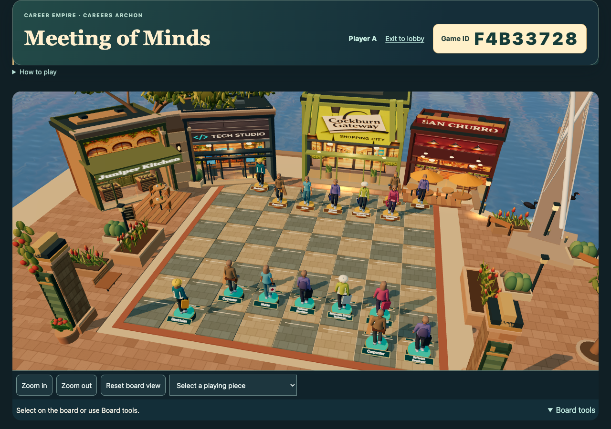
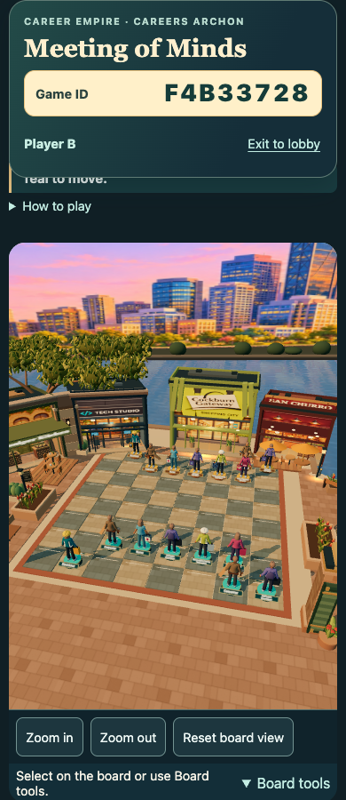

# Readable Careers Archon — 12 November 2026

## Problem and request

Tania reported a tiny Game ID, asked for a more attractive Meeting of Minds page and looping video, and supplied a desired front view plus Player B blocked by shop backs. She requested a brief overview after Start, then a useful playing angle. The existing Exit behavior and scheduled cleanup must remain unchanged.

## Bounded implementation

Seven source files at game baseline6d4c793: responsive warm-stone/teal header and larger readable Game ID; native existing lobby MP4 loops; both seats use the clear promenade-side camera with bounded orbit/zoom. A roughly3.6-second rendered-time overview is skippable and respects reduced motion. Start timing follows scene preparation, and the Skip overlay sits above the WebGL canvas. Reset/rejoin restore the whole-board view. Perth buildings, characters, game rules, scoring, private seat handling and hosted service/security are unchanged.

## Exact verification

Final source checks pass;382 tests across81 files pass with unchanged test limits, and351 asset hashes/104 reachable imports pass. Earlier concurrent worker/screenshot timeouts are retained; serial checks pass. Both seats at1280px and390px fit all64 square centres with no genuine world geometry in the rays, and Game ID text is at least26px. Reset and real pointer drags stay on the promenade side. Actual native video wrap, real Start/Skip hit target, automatic settling, reduced-motion bypass and ordinary Market/classroom-gate return pass with no page or HTTP errors.

## Genuine hosted gameplay and evidence boundaries

One owned fictional room completed8 duels across saved-room continuations, with both submissions, no pre-reveal answers in any seat payload/DOM, simultaneous reveal, adjudicator verdicts, territory persistence, three-seat rejoin and correct Teal win/Amber loss. That run exposed the final Skip issue before its repair; the unchanged game handlers/service were then paired with a new genuine Start/Skip/camera/Market-return retest of the final presentation repair. No hosted service responses were intercepted. Only hash-verified frontend/static resources were overlaid for staged browser qualification. The old room was confirmed unavailable before the one new final UI room was created. Private seat credentials remain private and are excluded from publication.

## Release and recovery

Tania directly authorized the executing integrator to clear release prerequisites and push live; her subsequent feedback scopes this successor. Intake CE-DISCUSSION-74a94ef4-3140-4f34-a5ec-75688a4072c9 is promoted here. Exact7 actual staged Git versions are bound in this record. The unchanged guard requires the published record and a legitimate receipt before normal game push. Confirmed target: Emmanuel-ICT-Support/GTCEM-Career-Empire main, Pages repository root. Candidate source review is complete; game publication and Tania appearance/classroom acceptance are separate. The saved CI workflow remains separate; existing software-runner installation failure is not an all-CI-green claim. Preserve paused Flyover, Chapel, EST, portfolio and queued Notes work. Rollback is a separately guarded successor; do not overwrite whole files from old candidates.

## Sources and continuity

User-supplied lobby, desired front-board and blocked Player B captures were inspected. No world art or character rescaling was produced. Existing native MP4,31 Archon assets, Carolan teaching guide and SCSA five ways remain intact. The original owner territory-persistence correction must survive any future backend rebuild; existing private scheduled cleanup is unchanged. Safari/native-device/classroom acceptance and Tania review remain distinct. Blueprint remains the planning reader; its embedded game is not deployment proof.

## Source files

- `modules/archon-careers/hosted/index.html` — `100644:4ebd4002e3982648b4ea3599575faa676722f366`
- `modules/archon-careers/hosted/parallel/gameplay/board-camera.mjs` — `100644:26e6aa2dcff100c55479a45cc8e009367df53cc1`
- `modules/archon-careers/hosted/parallel/gameplay/player.css` — `100644:357c619981b44dff41860417c08ab340f1622c25`
- `modules/archon-careers/hosted/preview.html` — `100644:8bf0b878080b9ed6ae6a086d3eaea2fd83dbc302`
- `modules/archon-careers/hosted/preview.js` — `100644:4823e7d37f3d07764eba4f804e7977032165073d`
- `playable-3d/release-manifest.json` — `100644:94b8fcc5dbba944e9158f6f0164a00603a9f7bd4`
- `tests/unit/archon-camera.test.mjs` — `100644:513204956e0914c7e730c5847d378dd190ea22db`

## Tested successor renders

Fictional test room, exact staged frontend. These are rendered browser captures, not mockups or Tania appearance acceptance.

