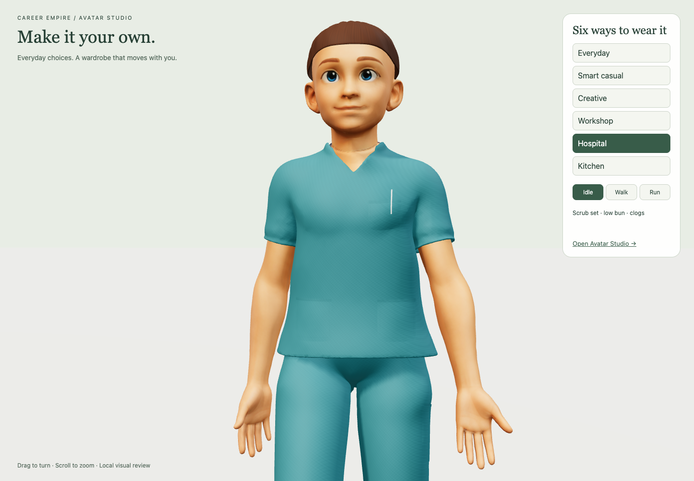
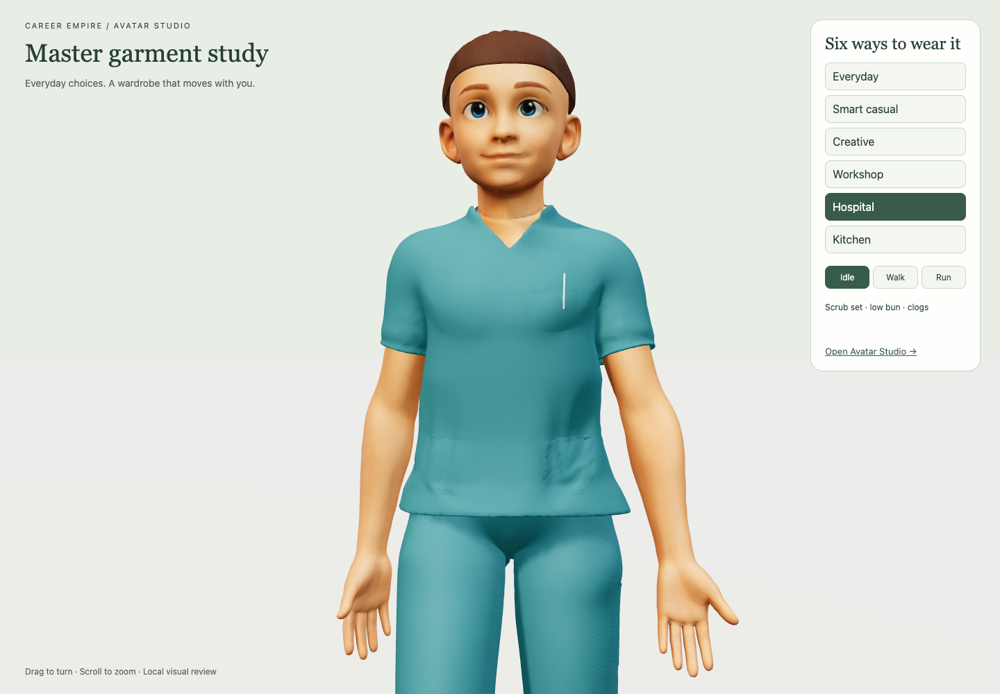
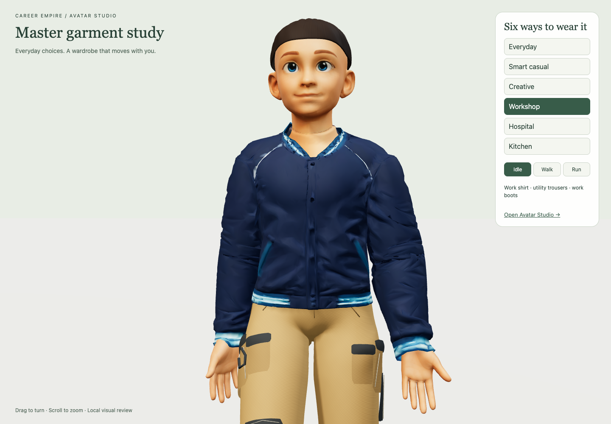

# Garment production proof — 29 September 2026

CE-CHANGE-20260929-99. Work performed locally; not an accepted visual upgrade or completed bulk-production workflow. Originals, full body, skeleton and live game remain preserved. No purchase, installation, deployment, new character body or body masking.

## What the source audit established

The current scrub source was generated by clipping/smoothing/offsetting the exact body surface, adding ease, and constructing details. The work/chef/suit sources extend that foundation. These are real editable Blender projects with working weights, but they are not a recovered collection of sewn garment patterns. The final occupational source contains 256px repeating weave/roughness maps; the source audit separates these garment maps from unrelated embedded avatar textures. Early scrub sources have no UV layer; later versions have one. We did not discover a hidden, detailed high-resolution garment sculpt/bake source for these current tops.

Recovered original Blender sources: Scrub-Shell.blend, Hospital-Scrub-Top.blend, Occupational-Tops.blend and Jacket-Fitting-Experiment.blend. The fitted Tripo jacket has 11,742 vertices / 22,783 triangles, original vertex colours, no UVs and no weights. Its static fit was never a production movement proof.

Native projects also exist in the Desktop Avatar Studio folder: Career Empire T shirt.zprj contains an embedded .zpac with garment data and seam-puckering image; pants projects and Pants.zpac also exist. Archive inspection is not visual/native pattern validation. No Marvelous Designer application was located in /Applications or ~/Applications. A question about its installation location is pending. Earlier chef-MD records explicitly report that imported Tripo mesh Auto Fitting was rejected; this audit does not repeat a promise that generic mesh import becomes editable sewn clothing automatically.

## Practical work completed

**Scrub study:** physically simulated the existing 6,106-vertex shell with the original body as a collider. Raw drape had unsuitable openings, so transferred restrained lower-torso drape onto the detailed fitted master, preserving the neckline/upper-body fit. Prepared an editable authoring scene and a 1K normal-map atlas. Tested a reduced mesh first: it introduced gait crossings and was rejected. Final study retains 27,966 triangles; the normal bake is not evidence of final polygon reduction or a complete high-to-low production pipeline. Removed the earlier procedural shader overlay for explicitly tagged authored garment materials.

Final scrub: same bone names, all vertices weighted, maximum four influences, zero finite edge crossings against the intact body at rest plus 16 native walk samples. Faster playback uses the same native gait. This does not establish exhaustive animation/layering safety. Overall art quality is still not established against Tania’s target; neckline/pocket construction and drape need stronger authoring. No claim that the supplied chef target has been matched.

**Jacket study:** bound the existing statically fitted Tripo jacket to the unchanged wardrobe skeleton using skin weights interpolated from the work-shirt master; preserved vertex-colour appearance and used a matte finish. Initial fit failed (maximum 594 edge crossings). Sample-based garment corrections reduced the final maximum to 398, but displaced some vertices by up to 0.0583m in authored units and did not produce an acceptable fit. This path is a failed production candidate, not a validated second master. Both pre-correction source and correction receipt are retained.

**Checks:** 93 unit tests and two scoped browser scenarios pass. Browser tests verify delivery, rendering and idle/walk/run controls; they do not override the failed jacket geometry checks. No full CI, sustained device benchmark, complete clothing-pair validation, final appearance acceptance or public release claim.

## Reference inspection

Rendered and inspected Nora, Sam, Mara, Dev, Kenji, Amina and NPC3–5. NPC3–5 identities are verified from the market build receipt. NPC1/2 files were not located in the searched folders; the other two market customers were not silently relabelled as them. The references show purposeful drape, distinct garment layers, readable cuffs/pockets, and mapped seam/colour detail. Their images here use Blender reference lighting; only the candidate before/after screenshots use matched game lighting.

## Status of the requested sequence

| Step | Result |
|---|---|
| Audit sources | Complete for located assets; native T-shirt archive found, native editing not yet verified |
| Finish a master to reference quality | Not achieved; scrub is a technical study, not an approved art master |
| Matched visual comparison | Captured before/after in the game; named references rendered separately |
| Motion/fit checks | Scrub sampled body checks pass; jacket fails; pair/physical-device checks incomplete |
| Second master and meaningful batch | Not achieved; jacket feasibility attempt failed; no new catalogue variants promoted |

## Concrete continuation

Open the located native T-shirt source in the garment editor, verify its avatar identity and inspect its actual patterns before choosing it for authoring. The current Blender shell alone has not demonstrated the requested garment construction quality. The missing work is a proper construction/drape/material pass, not another colour variant or source-file rename. If the native source cannot provide it through the available tools, use the supplied exact-body source package for a finite master-garment authoring handoff. No hiring or purchase has been undertaken.

Deliverables include source receipts, reproducible local scripts, editable study scenes, candidate GLBs and actual screenshots. The first rejected catalogue and older patch are historical and not an approved upgrade.

## Actual game comparison

### Tripo texture-style clarification — 29 September 2026
User screenshot shows Texture > 3D Model Texture Generator > Create Your Own Texture Style. Official Tripo documentation describes regenerating texture maps on existing geometry, with an image guiding appearance. This can change apparent fabric, colours and surface details, but does not construct separate interchangeable garments or new sleeve/collar silhouettes. Whole-avatar global texturing may affect skin/hair as well; do not promise garment-only preservation from this screen. Proposed bounded use: test texturing a copy of a separate existing garment, inspect export/UV compatibility and transfer maps to the retained rigged master if compatible. No credits spent, Tripo operation performed, or rig preservation verified. Sources: https://www.tripo3d.ai/features/ai-texturing and https://developers.tripo3d.ai/en/docs/models-texture .

## Wetsuit extraction — 29 September 2026
User requested extracting the base avatar wetsuit as a garment foundation. Extracted original fabric faces from studio-walking-base.glb into separate copies, preserving original UVs, coordinates and weights. 9541 vertices, 14983 triangles, 41 bones, zero unweighted vertices. Original source SHA256 unchanged. Front/back previews inspected; cut neckline/sleeve/leg edges remain slightly jagged and require authoring cleanup. No underlying body reconstructed and no clearance added: do not overlay coincident surfaces in game. Rigged textured GLB plus static neutral garment-only Tripo GLB and editable Blender scene supplied in /Users/tania.byrnes/Documents/Codex/2026-09-29/referenced-chatgpt-conversation-this-is-an/outputs/wetsuit-base. Tripo export/import not tested; gait not newly validated. This is a close-fitting foundation, not a completed loose garment or bulk-quality proof. No runtime change or deployment.

### Tripo chef texture trial rejected — 29 September 2026
Inspected user-supplied /Users/tania.byrnes/Downloads/trial+chef+jacket.glb (14983 triangles, no skin/rig). Render confirms white chef-style texture on the short-sleeved, thigh-length fitted wetsuit silhouette: painted collar/front closure/buttons, faded lower buttons, no jacket hem or separate trousers. User rejects result. This trial does not establish a useful chef garment or acceptable texture master. Stop pursuing wetsuit-to-chef conversion through texturing; correct garment geometry is required first. Source unchanged; preview outputs/wardrobe-references/Trial-chef-jacket.png. No game integration or Tripo credits spent by assistant.

## Direction corrected after history review — 29 September 2026
Tania explicitly does not want to reopen MD without a demonstrably solid route. Re-read original Avatar Studio Upgrade conversation and actual EveryWear/pants task, plus canonical 18–20 September experiments. MD fitting-suit/arrangement setup failed; imported chef Auto Fitting failed before/after simulation. Separate pants rigging/native game motion already succeeded. The unresolved work is quality asset authoring and fit/weight correction. Restore the 20 September stop rule: finite specialist master brief after repeated failed art experiments, not another user-led MD setup. Recommend small artist-authored/adapted pack against exact existing body; deliverables and review gates below. No supplier contact, purchase, commission, new asset or runtime change in this review. Procurement remains proposed. MD is optional for the asset author, not a Tania prerequisite.

# Career Empire: modular asset production brief

29 September 2026. Recommendation for review, not a procurement, supplier contact, purchase, appearance approval or release. This replaces the recommendation to ask Tania to locate/reopen Marvelous Designer. The current body, skeleton and walking system remain the target.

## Evidence and decision

The 18–19 September pants workflow already proved separate garments could share the 41-joint base rig and animate in Avatar Studio. Final fit/art remained incomplete. On 18 September, MD arrangement points and fitting-suit generation failed. On 20 September, imported Tripo chef mesh Auto Fitting failed both before and after simulation. Today's simple body-derived masters and chef-textured wetsuit have not met the requested visual standard. The 20 September repeatable wardrobe strategy already prescribed a finite specialist master brief when repeated modelling fails; that stop rule now applies. No further user MD setup is the next action.

Recommended acquisition: a character/technical artist with shipped modular game-character examples authors or adapts a small coordinated pack directly to the supplied custom body in Blender or their chosen authoring tool. Licensed source meshes can reduce work where editable topology, style and permitted game use are suitable. Tripo pieces can be candidate source geometry, but are not guaranteed modular, complete or rig-compatible. Do not buy a large generic pack before an exact-body sample passes.

## Pilot deliverables

1. One separate chef jacket with real collar, front overlap, sleeve/cuff and hem geometry; seams/fabric/pockets and small details appropriate to the camera distance.
2. One separate regular trouser master with usable waist/crotch/knee construction.
3. One recognisable work shoe pair with sole, upper and lacing/detail.
4. One textured hair asset with a convincing hairline, volume and strand/clump direction.
5. A second look from the approved masters: a deliberate short-sleeve/cuff variation and material variant. This must demonstrate reuse without restarting the avatar or fitting every colour individually.

The chef reference and Nora, NPC1–5, Sam, Mara, Dev, Kenji and Amina define visual intent. Copies of nine inspected named-reference renders are supplied; NPC1/2 sources are still unlocated and are not substituted. Authoring and in-game renders differ in lighting; final acceptance uses the actual game under matched lighting/camera.

## Immutable fitting contract

- Source: studio-walking-base.glb, SHA256 38631c75839ef638ce6821b9ccd7152cbc1f2ca75cd8c7d075c6c6847b732b3e. Include complete neutral/non-revealing source body.
- Preserve vertex geometry of the body, proportions, skeleton names/hierarchy, bind transforms, source orientation and native animation. Do not regenerate or independently auto-rig a dressed avatar.
- Source height is approximately 0.97947 units; runtime normalises the BODY to 1.7. Do not scale garments independently. Any authoring scene scaling must round-trip to original source coordinates and matrices.
- Each deliverable contains the separate asset mesh weighted to the target skeleton. Preserve usable UVs and embedded/referenced texture maps. Current loader expects skinned meshes, even for a head-only attachment: use weight 1 to the existing Head bone for rigid hair/hats/glasses.
- Keep at most four normalised joint influences per vertex for the current asset convention. Identical bone names alone are insufficient: validate bind matrices and geometry transforms.

## Asset-specific construction and animation

Clothes: fit purpose-built garment geometry with appropriate room around the body; transfer weights from compatible current references, then deliberately correct shoulders, armpits, hips/crotch and knees. Large folds/collars/hem silhouettes require geometry; bake small details to normal maps and use base-colour/roughness maps. No runtime cloth simulation is required for ordinary walking.

Hair: use shaped, textured clumps or hair cards appropriate to the style and renderer. Short hair can follow Head using one-bone weights. Long hair needs a deliberately fitted static style or an explicit secondary-motion design; swinging ponytails are not already implemented. Avoid promising realistic strands from current simple meshes.

Shoes: model separate fitted left/right shoes, with stable sole/upper shape and foot/toe weights; ankle/calf influence for tall boots as appropriate. Validate foot roll, ground clearance and trouser cuffs. Do not weight whole shoes like flexible trouser legs.

Accessories: glasses, earrings and hats can use head weights; hand-held rigid items use the corresponding bone where the game supports that slot. Backpacks and straps need their own fit/weight checks. These new slots are not currently promised implemented.

## Layering and validation

Define valid top/bottom/shoe/hair combinations. Fully covered body regions may be hidden reversibly in production, preserving the complete source and an unmasked diagnostic. Masking must never conceal broken silhouette, poor weighting, skin visible at openings or garment self-intersections. It is a separate implementation proposal, not current fit proof or permission to alter body geometry.

Gate A: front/back/side close-ups at the target game camera/lighting meet the visual references; garment openings and textures are coherent. Accept appearance before multiplying variants.

Gate B: the same files move on the original avatar in actual Avatar Studio and playable movement. Inspect idle, native walk, accelerated gait/run behaviour, turning/stopping and stress poses; inspect exposed neck/cuff/waist/ankle and supported combinations. A speed-adjusted walk is not a separately authored run animation. No detached parts, collapsing joints, visible penetration or ground sinking. Keep sampled collision tests as diagnostics, not the sole acceptance criterion.

Gate C: derive the second look without re-rigging the character. Colour variants share mesh and weights; structural changes retain correspondence where possible and receive motion checks. Only then expand family by family.

Gate D: measure triangles, draw calls, compressed bytes, selected-only loading and frame time in a representative game scene/device. Start with 1K–2K maps and few material slots per item, allowing exceptions only on measured visual benefit. These are proposed targets, not a device performance guarantee. No universal arbitrary triangle count substitutes for profiling.

Deliver editable source, separate runtime GLBs, texture sources/maps, palette/material masks, bone/transform metadata, compatibility list, source/licence provenance and actual game preview evidence. Garments do not need their own duplicate walking clips.

## Ownership and limits

Asset artist/technical artist: high-quality shapes, textures, topology and final deformation correction. This is the missing production skill/output. Supplier selection, budget and commissioning remain unapproved.

Codex: supply exact fitting kit and references; automate structural checks, weight-transfer starting points, exports, variant records and thumbnails; integrate shared-skeleton assets, implement justified layer rules, and test the actual game. Current scripted modelling has not demonstrated the requested art standard. Do not promise that more automation or finding MD will remove the skilled authoring requirement.

Tania: judge style against the supplied references and walking game preview. No garment-software operation is required of Tania by this recommendation.

## Sources

Local evidence: canonical Blueprint clothing-workflow-research-20260916.md, chef-fitting-20260920.md, avatar-wardrobe-strategy-20260920.md, hair-shoes-20260921.md and garment-production-proof-20260929.md. Read original Avatar Studio Upgrade chat and Update Avatar Studio evidence task, including actual EveryWear/pants exchange.

General shared-skeleton architecture: https://dev.epicgames.com/documentation/unreal-engine/fbx-skeletal-mesh-pipeline-in-unreal-engine . Engine-specific implementation remains our existing Three.js loader, not an Unreal migration. https://threejs.org/docs/#api/en/objects/SkinnedMesh . Tripo documentation confirms segmentation exists; it does not establish exact-body fit or clean reusable garment construction: https://www.tripo3d.ai/blog/can-ai-complete-missing-parts-of-a-3d-model .

### Commissioning enquiry route — 29 September 2026
Tania asks who/how to commission. Researched two enquiry leads: Archit Gupta (https://architgupta3d.com/ ; https://architgupta3d.com/ritaandmurphy ; https://architgupta3d.com/chibijinx ; contact https://www.upwork.com/freelancers/architgupta3d) and Collin Myhre (https://collinmyhre.com/). Their first-party portfolios show stylized game-character modelling, rigging and real-time preparation. Archit documents deformation testing and GLB delivery; Collin documents rigged/skinned Unity-tested OKTO DanceIt. Neither is verified for this exact skeleton or a modular wardrobe commission. Availability, price, turnaround and terms are unknown. Suggested initial enquiry goes to both with supplied fitting kit and references, requesting a fixed-price paid chef-jacket pilot before contracting the full outfit/library; ask for comparable existing-rig clothing motion evidence and included source/maps/revisions/commercial-use terms. This is a smaller first contracting milestone within the previously proposed complete-outfit pilot. No outreach, submission, payment or hiring done. Draft: outputs/Avatar-artist-enquiry.txt in the current Avatar Studio task. Upwork supports funded fixed-price milestones with a 14-day submission review period, after which payment auto-releases if no action: https://support.upwork.com/hc/en-us/articles/17974824831507--Review-and-pay-for-fixed-price-contracts-and-milestones .

## Commission scope corrected by Tania — reusable templates, 29 September 2026
Tania explicitly corrects the one-chef-jacket ad: the intended commission is reusable, customisable garment templates fitted/weighted to the existing avatar, from which the team creates its own outfits. Supersedes earlier single finished-jacket enquiry scope. Draft Fiverr brief covers regular tops, structured jackets and trousers as proposed families, named editable components, tested structural presets, independent materials/masks, documented limits and example variants. Ask seller to justify family boundaries; do not promise one universal mesh or arbitrary automatic rig-preserving changes. A paid initial milestone, if chosen, must deliver a reusable master plus two variants and editing instructions, not merely a finished chef look. Routine customisation should work in Blender without Tania reopening MD. Family count, budget, dates and supplier remain unagreed. No ad posted or seller contacted. Current draft: outputs/Fiverr-garment-template-brief.md.

# Create reusable, rigged clothing templates for an existing game avatar

## Project
I’m developing Career Empire, a stylised 3D education game with an animated avatar and a working interchangeable-clothing system.

I need a small library of high-quality, editable garment templates that we can customise and reuse to create different everyday and career outfits. The main deliverable is a reusable clothing system at the asset level, with finished example variants demonstrating how it works.

## Template families
Please propose and quote a practical starter set covering:
- A regular top/shirt template with tested short- and long-sleeve options, collar/neckline choices, cuffs, pockets and front-panel details. Intended looks include work shirts, scrubs and chef jackets; explain which can share a template and which need a separate master.
- A structured jacket/blazer template with appropriate lapels, opening, lining at visible edges and room over compatible tops.
- A trouser template with waist, pocket, hem and length options, supporting trousers and shorts where practical.

Skirts, footwear, hairstyles and accessories may follow as separate template families. Please price these separately if you offer them.

## Customisation requirements
- Organised, named components and editable source geometry.
- Clearly defined, tested options for sleeves, collars, cuffs, pockets, hems and other supported details.
- Separate material regions or masks for fabric, trim, buttons and details, so colours and fabrics can change independently.
- UVs and textures designed for reuse across compatible variants.
- Rigging that remains usable for supplied configuration options; identify changes that require additional modelling or weight correction.
- Demonstrate at least two visibly different looks from each agreed master and provide simple instructions or a short recording showing us how to create them.

Please explain your proposed template method and its limits before work starts. We do not expect every possible garment to come from one universal mesh.

## Existing avatar and movement
We supply the exact base avatar, its existing 41-bone skeleton and walking animation. Preserve its body shape, proportions, bone names and bind pose. Each garment must be a separate mesh fitted and weighted to that skeleton and compatible with our existing animation.

Check the agreed variants in motion, including shoulders/armpits, elbows, waist, hips and knees. Our team will also test the files in the game. Agree compatible layers and combinations rather than assuming every combination works.

## Visual quality
The target is polished stylised game art with believable clothing construction: convincing silhouettes, collars, cuffs, hems, pockets, fabric and restrained folds. Reference images will be supplied. Assets must remain practical for a real-time browser game, with sensible mesh and texture budgets agreed after reviewing the avatar.

## Deliverables
- Editable Blender master files, logically organised and documented.
- Separate rigged garment GLBs for the agreed templates and example variants.
- Texture maps and editable material/colour masks.
- A list of supported configurations and compatible combinations.
- A short customisation guide or recording, plus movement previews.
- Terms allowing us to use, modify and create derivative clothing for our game; disclose third-party assets and their restrictions.

You may use your preferred authoring tools, but routine customisation of the delivered templates must be possible in Blender without requiring us to reopen Marvelous Designer. Please explain any dependencies.

## Your proposal
Please include relevant examples of modular clothing or reusable character assets, preferably moving on an existing rig. Explain your template approach, suggested master families, what we can safely customise ourselves, price by phase, timeframe and included revisions.

We are open to a paid first milestone delivering one complete reusable template and two demonstrated variants, followed by the remaining agreed template families. Please quote for reusable masters and their customisation workflow, rather than only individual finished outfits.

### Fiverr Mira interaction request — 29 September 2026
Tania explicitly asks Codex to access Fiverr and converse with Mira about the corrected reusable-garment-template brief. Supplied screenshot shows Mira interpreted wardrobe as physical furniture. Available-tool discovery found no callable browser/computer-control tool for that logged-in session; no login or message sent. Prepared a copyable clarification specifying digital 3D game-avatar garment templates, exact existing rig, editable Blender assets, demonstrated variants and relevant game-character artist experience. This user authorisation is for the AI brief conversation; no supplier hiring or payment requested.

### Mira asks for project reference files — 29 September 2026
Tania supplies Mira's request for game link, avatar/rig files, art and technical brief. Prepared local Fiverr-avatar-template-reference-pack.zip with corrected reusable-template brief, unchanged source GLB, nine NPC renders, supplied chef target image and fresh rig-spec.json (41 joints, embedded Walk - supplied exact base; source hash unchanged). Public game URL remains https://emmanuel-ict-support.github.io/GTCEM-Career-Empire/playable-3d/ ; web retrieval was inaccessible this turn, so no fresh hosted-health claim. Draft response tells Mira exact attachment is the avatar authority and reference images set target art quality. No upload or external message performed.

### Fiverr brief navigation clarification — 29 September 2026
Tania clarifies that the public game link does not open Avatar Studio directly; reviewers must select Avatar Studio from the game's dropdown menu after loading. Added these explicit instructions to outputs/Fiverr-garment-template-brief.md and the revised Fiverr-avatar-template-reference-pack-v2.zip (README plus OPEN-AVATAR-STUDIO.txt). Original package retained. This is a brief/package edit only; no direct Studio link or runtime change implemented. Revised ZIP integrity checked.

### Mira template-count question — 29 September 2026
User confirms navigation through Places → Avatar Studio → Dressups. Updated brief and reference-pack-v3 ZIP accordingly. Mira asks for family/variant count. Recommended quotation scope: three reusable templates (regular shirt, structured jacket, trousers), two demonstrated configurations each, six looks total including base configurations. Shirt long/short sleeves; jacket two mutually compatible structural/detail configurations to agree with artist; trousers full-length/shorts. Recolours alone do not count. Chef/scrub or other different silhouettes require explicit master-family feasibility and separate quote when necessary. Hair/shoes later. Counts are assistant recommendation pending Tania's choice, not a placed order or supplier agreement. No external message/upload performed.

### Mira indicative budget and timeframe — 29 September 2026
Tania relays Mira's planning suggestion of USD900–1500 and21–35days for first phase, including a paid pilot before remaining masters. This is Mira's estimate, not a seller quote, market-rate verification, accepted budget or deadline. Draft response keeps quotation open and requests separate prices for one reusable pilot template/two configurations and the remaining two masters/four configurations, plus source files, customisation guide, textures, rigging, in-game correction/revision scope and use/modification terms. No acceptance, contact, order or payment performed. Reference-pack-v3 remains unchanged; no unapproved price/date added to the technical source-of-truth package.

## Budget correction from Tania — 29 September 2026
User-supplied Mira screenshot shows Tania saying the suggested commission is unaffordable and she had been thinking around AUD150. Treat this as the available overall budget context, not assumed funding for a later larger commission. Earlier USD900–1500/21–35day range is rejected/unaffordable; no spending approved. Three-master scope remains an aspirational library, not a credible funded commitment. Recommend asking sellers what reusable output is feasible within approximately AUD150 total, potentially adapting an existing editable/licensed garment to the exact avatar instead of creating a new asset from scratch. One regular-top master with editable materials and a supported sleeve option is a proposed reduced target; fit, weights and variants at this price are unverified. Do not promise two variants or ongoing paid work. Get exact deliverables, total AUD cost including applicable fees and existing-rig proof before deciding. No deadline supplied; do not invent one. No reply sent externally or reference upload performed.

### Mira search preferences complete — 29 September 2026
Tania reports answering no to additional location/time-zone/language/communication search preferences. Mira proposes a quick regular-top pilot within AUD150; quick turnaround was introduced by Mira, not a user deadline. Recommend requesting the actual shortlist with relevant work, exact deliverables, total price and realistic timeline, keeping quality/reusability and existing-rig compatibility ahead of speed. Budget remains approximately AUD150 overall; no artist selected, quote accepted, external message sent by Codex or payment made.

### Fiverr technical PDF reviewed — 29 September 2026
Inspected all five pages of user-supplied reusable-avatar-top-pilot-brief-technical.pdf, including rendered layouts. Core existing-rig target and Places → Avatar Studio → Dressups route correct. Corrections needed: remove ASAP, retain authoritative A$150 total incl applicable fees rather than unlabelled $105, make second sleeve configuration conditional on quote feasibility, require editable Blender sources, exclude unagreed collar/cuff/pocket/hem modules. Both referenced ZIPs contain superseded larger briefs; created one current pilot-only package with unchanged avatar/references and explicit current scope, optional sleeve configuration and no assumed future spend. PDF original preserved; no posting or external upload. Current proposal artefacts: outputs/Fiverr-regular-top-pilot-current.md and .zip; review receipt outputs/Fiverr-pilot-PDF-review.json. Supersedes earlier packs for current seller enquiry. No seller feasibility or price acceptance claimed.

### Fiverr currency clarification — 29 September 2026
Tania clarifies Fiverr must convert the budget to USD. Supersedes recommendation to remove the USD field/conversion. Retain platform-required USD amount, label currency explicitly and preserve A$150 including applicable fees as the underlying total budget. No current exchange rate or exact US$105 conversion independently verified; do not declare conversion wrong or guarantee checkout total. Current pilot brief and ZIP updated. Other PDF scope/timing/source-file corrections stand.

### Character Creator comparison and custom-avatar limits — 29 September 2026
Tania asks which Windows software provides character dressing/rigging and whether it is better than Marvelous Designer. Identified Reallusion Character Creator (current CC5). Current official sources distinguish character assembly/customisation, wardrobe/hair/shoe fitting and game preparation in CC's native ecosystem from Marvelous Designer's garment-pattern construction and cloth simulation. CC is closer to the desired integrated wardrobe experience, but this is not proof of compatibility with the existing exact Tripo body and 41-bone rig.

The CC5 manual explicitly distinguishes Standard CC/iClone characters from imported/characterised Humanoid characters; Humanoid characters cannot exchange clothes or shoes through the Standard wardrobe workflow. AccuRIG creates a Reallusion skeleton, so its import/rigging support must not be represented as preserving the exact supplied rig or enabling native CC clothing automatically. No custom-avatar proof or game integration performed.

Licensing is a separate project-specific limitation: current Reallusion software EULA (25 May 2026), section5.2A, restricts use of CC base-model outputs in any character-generation system. Ordinary permission to export characters to games is not evidence that Career Empire's player-facing Avatar Studio is covered. Written clarification/permission from Reallusion for the intended use would be required before adopting that route; no assumption that a particular licence tier solves this. This does not assert that all original custom assets created with the tool are prohibited.

Recommendation: do not buy or restart the avatar pipeline based on general CC marketing. Exact-body/rig compatibility and usage rights would need resolution first. Existing reusable-top enquiry, approximately AUD150 overall budget, and no-return-to-MD-without-demonstrated-route instruction remain unchanged. Research only; no purchase, installation, avatar replacement, external contact or deployment.

Official sources checked:
- https://www.reallusion.com/character-creator/
- https://manual.reallusion.com/Character-Creator-5/Content/ENU/5.0/05-Character/Characters-in-Character-Creator.htm
- https://manual.reallusion.com/Character-Creator-5/Content/ENU/5.0/09-AccuRIG/Creating-with-AccuRIG.htm
- https://www.reallusion.com/character-creator/cc-avatar.html
- https://www.reallusion.com/Content/EULA/AP/EULA_AP.htm
- https://www.marvelousdesigner.com/explore/solutions/3d-clothing-avatar-modeling-software

### Upwork pitch — 29 September 2026
Tania requests the complete commission pitch within 1500 characters for Upwork. Prepared outputs/Upwork-reusable-top-pilot-pitch.txt, preserving the current single reusable regular-top scope, exact avatar/unchanged 41-bone rig, essential editable Blender source/textured GLB/material controls/reuse guide, movement preview and agreed in-game corrections. Sleeve configurations remain conditional on quote feasibility. Total budget remains A$150 including applicable platform fees; request a USD quote without asserting a verified conversion. No fixed deadline or later work promised. Rights must cover modification and the game's avatar customisation system; source restrictions must be disclosed. Includes public game URL and Places > Avatar Studio > Dressups route. Draft only; no posting, contact or purchase.

### CONNECT existing/free garment route — 29 September 2026
Tania identifies CONNECT inZOI Gamewear, including free garments. Official Gamewear upload guide states purchasers receive game-format packages, not the optionally uploaded ZPRJ. Recolor option describes inZOI ModKit support, not general editable-master availability. Distinguish these mods from ordinary CONNECT garment listings that provide ZPRJ/ZPAC and sometimes FBX/glTF. Existing/free source garments remain a credible starting point for adaptation; no suitable exact-avatar asset or licence validated yet. Example Streetwear Tshirt Model008 offers source/mesh formats but reports547k thin-mesh triangles, illustrating why format availability alone is not game readiness. Recommend checking reusable source availability, modification/game-distribution rights and practical optimisation/fit before commissioning from scratch. Artist could quote adaptation/weighting/Blender handover instead; do not promise budget feasibility or ask Tania to reopen MD. No download/purchase/contact performed.
Sources: https://support-connect.clo-set.com/hc/en-us/articles/51485466956441-Upload-to-Gamewear ; https://support-connect.clo-set.com/hc/en-us/articles/45304270498969-Creating-3D-Garment ; https://connect.clo-set.com/detail/d19853090cf84ac1ab9a04f2b9f98e18

### Supplied tracksuit ZIP inspected — 29 September 2026
Read ZIP directory and manifests of Downloads/M Panelled Street Tracksuit Set.zip without executing or extracting package content. Contains inZOI ModKit Windows .pak/.ucas/.utoc containers, plugin/manifest files and garment JSON patches. No exposed .zprj/.zpac/.blend/.fbx/.glb/.gltf source files or licence document. Manifest lists garment mesh/material/texture references plus game skeleton and dependencies; this is not an editable master delivery or existing-avatar compatibility proof. No extraction/conversion, installation, modification or purchase performed. Request original editable garment source or choose regular CONNECT garment listings with source/mesh formats and appropriate reuse rights; free assets remain a possible route.

### CGTrader free clothing shortlist — 29 September 2026
User requests search of CGTrader free clothing. Inspected catalogue and individual seller listings. Useful source candidates (listing claims only; no files downloaded or actual visual/fit approval):
- Female regular tshirt: https://www.cgtrader.com/free-3d-models/character/clothing/female-regular-tshirt — description ZPRJ, OBJ/FBX, UVs/textures; download table FBX and ZPAC; tagged rigged, but exact41-bone compatibility unverified. First regular-top source candidate.
- Polo Shirt: https://www.cgtrader.com/free-3d-models/character/clothing/polo-shirt-533a4346-014f-4ea9-8e20-9af8a5fea984 — native Blender, FBX/OBJ/glTF and textures; large listed glTF90.8MB means performance must be inspected/optimised, not assumed game-ready.
- Free Mens Shirt: https://www.cgtrader.com/free-3d-models/character/clothing/free-mens-shirt — project source plus FBX/OBJ, described highpoly quad mesh on CLO/MD mannequin, needs optimisation/refit.
- Male blazer jacket: https://www.cgtrader.com/free-3d-models/character/clothing/male-blazer-jacket-e1ce9e39-bb87-486a-9951-31de987ac566 — garment FBX/OBJ, project source, textures/UVs. Listed animation is360-degree rotation, not walking proof.
- Jacket sweatshirt: https://www.cgtrader.com/free-3d-models/character/clothing/jacket-87b817e7-e351-4777-86ba-0f214284395d — OBJ/textures, seller reports2256triangles. Optional lightweight candidate, not appearance approved.
Listings distinguish Royalty Free (no AI) from unrestricted use. CGTrader official policy https://help.cgtrader.com/hc/en-us/articles/360015124437-Royalty-Free-License permits incorporated game use subject to asset-access safeguards. Publicly served editable GLBs in browser game need clarification/appropriate permission; do not mark licence cleared from badge alone. No contact, account action, purchase or download. Preview image requests failed, so no rendered visual inspection claimed. Recommend source inspection of regularTshirt and Blender polo before scratch commission; artist can quote adaptation and exact-rig weighting.

### CGTrader regular T-shirt OBJ archive inspection — 29 September 2026
Supplied Downloads/OBJ.rar safely listed and extracted to task outputs/cgtrader-tshirt-inspection. Nested OBJ.zip contains two100,100,826-byte OBJ files and twoMTL files only. Both meshes identical after excluding comment/mtllib lines:505023vertices,889258triangular faces,505023UV entries and normals; five unique used material names. No texture images, garment project source, skeleton or weights in this archive. Suitable editable high-resolution source candidate, not game-ready or motion-tested. Need optimisation/retopology and baking as appropriate, exact-body fitting/weighting, material completion. Blender5.2.1 background preview attempt crashed(exit139); no rendered visual approval claimed. Source preserved; no game integration or licence clearance.

### Full T-shirt source package inspected — 29 September 2026
Extracted supplied UVMAP/RENDER/ZPRJ/TEXTURE/FBX RARs into inspection folder after path validation. Visually inspected supplied front render: crew-neck ribbing, sleeve/hem stitching and natural drape provide useful source-art detail; this is seller render, not our game. ZPRJ contains two actual project containers, A includes an .avt avatar while B does not; both contain .zpac garment data. Not application-open validated. UVMAP is six4096x4096 material maps(diffuse/normal/roughness/opacity/metalness/displacement), correcting earlier guess that it only contains guides. TEXTURE contains fabric/rib/stitch resources. Sixteen render images. Both ASCII FBX files contain505023vertices/889258triangles, no Deformer or LimbNode entries: no skin rig in delivered FBX, despite listing rigged tag. Need low-poly conversion, texture/material setup, exact-body fit and existing-rig weights. No motion or game integration claim; no MD reopening requested.

### User-requested direct T-shirt fitting and side-view correction — 29 September 2026
Tania asks Codex to fit the supplied garment, then rejects initial side-view screenshot showing detached torso/sleeves and shoulder clipping. Initial front-based preview was premature and not accepted. Built isolated Blender pipeline in task work/tshirt-fit, retained downloaded source and canonical body. Sandboxed Blender startup crashed in Metal initialisation; authorised graphics-access execution works. Converted source geometry to13999triangles/5787vertices, original41-bone rig,max4normalised weights; maps2K. First affine/nearest-push trials distorted seams and fit; final candidate uses joined close seam vertices, smooth clearance corrections, capped excess body standoff, weight recalculation after fitting and two sampled pose-correction passes.

Final local garment GLB 5212648 bytes. Source body hash unchanged: 38631c75839ef638ce6821b9ccd7152cbc1f2ca75cd8c7d075c6c6847b732b3e. Rest plus16native-walk samples have zero two-way finite edge crossings. Not swept collision, arbitrary pose or layer proof. Source rig reused, no body deletion/coverage mask. Existing Three.js loadProfileKit/createCharacter loader used in new tshirt-fit-review.html/js; candidate asset cgtrader-tee-fit-study.glb is isolated and not a catalogue replacement. Browser loads candidate and Walk keyboard activation verified; final runtime views/limits documented in work/tshirt-fit/README.md and delivery-report.json. Run control is existing faster walk, not distinct animation.

Front/side/back renders reviewed; side standoff/shoulder coverage improved after user rejection. Collar/hem/seam quality remains unfinished, so no high-quality master acceptance or production readiness claim. Local only; no external publication/licence clearance. Original game runtime/avatar source preserved.

Final local browser check: corrected side camera and Walk selection verified. Disabled receiving shadows on the study garment to remove preview shadow acne; garment still casts shadows. Saved browser-side-walk.png under the isolated tshirt-fit workspace. Collar and hem remain a visual draft; this is not production acceptance or deployment.

### 30 September: direct Marvelous Designer attempt
User rejects current tee quality and asks whether desktop control can create garments in MD. Verified installed MD 2026.1.149 opens already signed in. No specialised MD connector/bot available; native UI control can inspect editor. Proposed bounded route: supplied real T-shirt ZPRJ patterns, exact existing avatar at verified scale, cloth drape and silhouette approval before optimisation/weighting/runtime checks. Copied source A to task work/md-tshirt-pattern-fit/Tshirt-source-copy.zprj (and /tmp/tee.zprj for shorter picker path). Native file-picker typing resolves the file, but Return and exposed open action fail to open it reliably. No pattern edits, simulation, new fitting result, account change or deployment. Next step: open copied ZPRJ in MD, then establish exact-avatar scale/arrangement; do not claim MD route proven.

### 30 September: user-supplied MD retargeting tutorial
Reviewed auto-generated transcript of https://www.youtube.com/watch?v=Uv0x6CKUQB0 (Marvelous Designer Avatar Retargeting & Clothing Fit Workflow). Demonstrates custom-avatar Fitting Suit landmark setup, saved avatar, retarget draping, Auto Fitting, manual corrections and finer simulation. Official Auto Fitting documentation https://support.marvelousdesigner.com/hc/en-us/articles/47358335130649-Auto-Fitting confirms BOTH target avatar fitting suit and garment fitting-suit data are required. Next bounded experiment: validate source garment fitting data, create/reuse exact-avatar fitting suit at correct scale, re-drape and auto-fit supplied patterns, visually assess side/back before rig transfer. Tutorial does not prove our asset compatibility, rigging or runtime fit. No new garment modifications in this review.

30 September live MD observation: user has opened tee.zprj with the familiar wetsuit avatar and editable tee patterns. Screenshot shows shirt floating above avatar and larger than its torso; exact scale and fitting-suit presence not yet verified. Simulation off. Previous file-open blocker resolved by user. Read-only inspection; no edits. Prioritise avatar scale and fitting-suit calibration before garment retargeting.

30 September fitting-suit operation blocked: opened Avatar Editor > Fitting Suit; MD warned less than 10GB available and potential file damage. Cancelled, then MD displayed Fail to load and changed scene title to Untitled. No fit created or saved. Disk check reports 2.3GiB available on internal data volume; memory_pressure reports47% free. Do not overwrite tee.zprj from current Untitled state. Free disk capacity before reopening saved avatar/tee and retrying. No files deleted or cleanup authorised.

30 September read-only storage shortlist for MD blocker: free2.3GiB. Candidates measured: Downloads/MarvelousDesigner_Personal_2026_1_149_Installer.dmg2.10GiB; Library/Caches/com.openai.codex/org.sparkle-project.Sparkle/Installation3.51GiB; Library/Caches/com.anysphere.sand.ShipIt0.31GiB; Library/Caches/notion.id.ShipIt0.29GiB; Library/Caches/notion-updater0.23GiB; Library/Caches/ms-playwright1.88GiB. Combined roughly8.3GiB, reclaim may vary. These are candidates, not approved removals; updater/runtime use must be checked before removal. ps unavailable in sandbox. No deletion, no OneDrive or project cleanup. User approval requested for exact shortlist.

30 September approved cleanup completed: ejected MD installer disk, removed named installer, inactive Codex Installation/XUazy5wCd and iolJRsUf9, com.anysphere.sand.ShipIt and ms-playwright caches after open-file check. Notion updater running, so both Notion caches retained. Actual free bytes rose2509078528 to10895818752 (8.39GB reclaimed;10.90GB free). Receipt: task outputs/md-space-cleanup-20260930.json. No project/garment/OneDrive removal. MD fitting still pending; space barely above10GiB.

30 September fitting-suit review: restored tee from Recent; imported Downloads/studio-walking-base.glb at173.56% metres (source height0.9794712m, game target1.7m), joint/blend animation disabled for rest-pose fitting; auto fitting data generated and Drape Fitting Suit run. User rejected premature save and explicitly requires all-angle/ankle correction before saving. Save dialog cancelled; NO fitting suit saved. Front shows both red ankle edges above purple ankle guides with exposed strips. Side/back NOT inspected: Display viewpoints disabled in fitting mode; native viewport right-click failed windowNotFoundAtPosition, drape controls did not visibly stop simulation. Do not claim100%fit or validated reusable master; preserve current unsaved state. Need reliable viewport control to inspect and correct landmarks/drape before saving or garment retargeting.

30 September user clarification: permission to manipulate MD is already granted; viewport failures are control limitations, not missing consent. Fitting suit is reusable auto-fitting correspondence, not proof of animated garment skinning. Validate landmarks and draped suit from all views, then test representative top AND full-length trousers through native walk after weighting on unchanged41-bone rig. MD cloth simulation and game skinning are separate acceptance checks. No save until current fit resolved as user instructed. Earlier claim near-perfect fitting suit removes essentially all future garment adjustments was too strong; ankle guide discrepancy requires inspection, not assumed automatic failure of all trousers.

### 2026-09-30 — Rear calf inspection and camera guidance
User reports a left-calf issue. Current MD screenshot shows a small blue circular marker on the rear left calf; its function is unconfirmed and it is not evidence of a mesh hole. Feet remain cropped at viewport bottom. Pan/zoom guidance supplied; fit remains unvalidated and unsaved under the explicit no-save instruction. Official View Controls documentation consulted.

- 2026-09-30 rear ankle check: user confirms blue dot is editing marker and Preferences disabled. Live rear view now shows both ankles, with narrow skin bands between red suit edges and purple guides; no large rear-calf protrusion apparent at this view. Escape did not clear marker. No geometry edits or saving; full fit remains unvalidated.

- 2026-09-30: Requested side ankle inspection attempted using camera shortcut and viewport focus. Camera remained rear-facing; input instead selected menu headings, with repeated app-changed interruptions. Side close-up NOT obtained. No save performed; do not claim ankle fit validated. Manual camera rotation is required to unblock current inspection.

- 2026-09-30: User repositioned camera; live screenshot confirms low oblique side view with both ankle regions visible. Red fitting-suit ends appear above purple ankle guides with narrow exposed bands. Perspective/grid limits precise assessment; this does not establish that future trouser hems will be short. No edits or save; fitting remains unvalidated.

- 2026-09-30: User defers fitting-suit perfection until workflow proof. Recommended route: retain fitting data in MD AVT, verify source tee garment fitting data, Auto Fit and simulate tee, export actual garment to Blender for optimisation and original-rig weighting, then test game walk/run. Fitting suit is MD adaptation data, not automatically a rigged reusable game garment. Official MD Auto Fitting documentation verified; no export/save claimed this turn.

- 2026-09-30 T-shirt workflow attempt: verified saved New test avatar base rig.avt (approx 3 MB) and preserved CE-avatar-fitting-test-20260930.avt in md-tshirt-pattern-fit. Closed Avatar Editor successfully; garment workspace was empty. Attempted File Recent /private/tmp/tee.zprj; MD issued less-than-10GB file-damage warning. Cancelled warning, no Auto Fit performed. Disk reports 9.3 GiB available. Resume after disk headroom restored: open source tee, load saved target AVT, check garment fitting data and Auto Fit. No garment success or animation validation claimed.

- 2026-09-30 storage options audit, read-only: free approx 9.99 GB. Candidates: ~/.npm/_cacache 2.2 GiB package download cache; Edge cache 878 MiB (close browser first); Notion updater caches approx 0.56 GB (must verify updater inactive). Codex cache 1.3 GiB active-app cache deferred. No files deleted. npm download cache recommended as first bounded cleanup pending user approval.

- 2026-09-30 approved cache cleanup: removed only ~/.npm/_cacache; recovered 2,372,452,352 bytes. Free space 13,181,640,704 bytes (13.18 GB). Edge, Notion/ShipIt and Codex confirmed running, so their caches deferred. Project files and installed dependencies preserved. Receipt: outputs/cache-cleanup-20260930.json in avatar task root. MD loading not yet re-tested.

- 2026-09-30 post-cleanup resume: initial MD accessibility state reported Base Avatar Fitting Suit Tshirt.zprj, but subsequent live screenshot shows CLO-SET sign-in screen. No garment mutation performed; current blocker is sign-in. Auto Fit remains unverified.

## 30 September evening — project and avatar preservation verified

Tania saved `Documents/md/New Assets/Avatar/Base Avatar Fitting Suit Tshirt.zprj` (20,492,779 bytes; SHA256 `55c3317882276f64f24680da840bb1bee4b39d90672d7588e5f7308e0e7695f5`). Live native screen showed the grey short-sleeved tee on the avatar and editable patterns. Codex subsequently saved a separate new `Base avatar with fitting suit.avt` through File > Save As > Avatar (3,386,231 bytes; SHA256 `13026b1035f52ba854993ea741869563b725d4ef25069088e307ce6b1afefdb6`). Both archives passed ZIP CRC checks; byte-identical backups and receipts are in `/Users/tania.byrnes/Documents/Codex/2026-09-30/task/preservation-20260930/`. Original project, earlier AVT and autosave were retained. The project contains embedded avatar and garment archives. This verifies saved artifacts, not successful native reload, fitting-suit completeness or movement acceptance.

Official Auto Fitting documentation states the fitting-suit Save operation stores the avatar and fitting-suit data in AVT: https://support.marvelousdesigner.com/hc/en-us/articles/47358335130649-Auto-Fitting . Binary archive inspection alone cannot confirm the fitting data is usable. Following the successful save, a fresh UI read unexpectedly showed CLO-SET sign-in; this task did not close/restart/sign out/reset the application. Native persistence verification is pending sign-in/session recovery. Do not replace this actual new-save evidence with the older unsaved-state notes.

Next bounded proof: reopen preserved copies when safe, verify avatar and garment fitting data, export the actual MD-draped tee, preserve its construction/UVs, round-trip scale to the unchanged 41-bone source, transfer/correct weights, and test front/side/back plus native gait in the existing shared-skeleton loader. Prior OBJ tee results do not validate this MD garment. Reuse the already fitted braided ponytail at `~/.codex/.chatgpt-projects/g-p-6a8fb599c60c8191bf40932aaef8268b/hair-review-20260929/preview/`; stored report: 35,155 triangles, 2,842,660 bytes, 1K maps, Head weight 1, zero head-relative drift in 41 samples. Hair/tee appearance, collar interaction, selected-only loading and sustained device performance remain separate gates. No new runtime integration, catalogue replacement, publication or Week 1 work in this preservation checkpoint.

## 30 September evening: exact-base authoring correction

Tania explicitly directed restarting the fitting suit on the exact game avatar, retaining existing tee patterns. Historical `Base+model.glb`/28,956-vertex authoring avatar and its fitting-suit files are retained but retired from future canonical wardrobe authoring. Do not continue offset/weight corrections against that mismatched authoring body.

Authoritative runtime source verified in `avatar-quality/playable-3d/characters.js` (`pantstest` route): `assets/studio-walking-base.glb`; SHA-256 `38631c75839ef638ce6821b9ccd7152cbc1f2ca75cd8c7d075c6c6847b732b3e`, 31,598 vertices, 46,097 triangles, 41 bones. Source rest height approximately 0.979471m; runtime uniformly normalizes to 1.7m. Runtime source remains unchanged.

Working root: `/Users/tania.byrnes/Documents/Codex/2026-09-30/task/correct-base-20260930`. A byte-identical GLB copy was imported directly in MD 2026.1 at metres/100%, Y-up, no ground alignment or joint animation; no geometry conversion was needed. Auto Create Fitting Suit was enabled. Separate `Exact game base 38631c75 with fitting suit.avt` and `Exact game base 38631c75 - tee fitting work.zprj` were saved, CRC checked, and protected copies retained. Both were natively reopened and suit wireframe persisted. A dedicated Drape Fitting Suit operation was then performed and saved as `Exact game base 38631c75 - draped fitting suit.avt`; this later revision still needs native reopen validation.

Acceptance remains OPEN: generated suit has a visible protruding patch near one hand; tee Auto Fitting rejected the first attempts with “It only works for a simulated garment.” Existing six tee patterns/fabrics remain reusable and preserved; fitting diagnosis is ongoing. No all-angle fit approval, corrected-base motion pass, final hair integration, or physical-device performance acceptance is claimed. Earlier mismatched tee collision correction/report is historical only. Do not start Week 1 or publish/replace live wardrobe assets.

### Correct-base native drape milestone (same evening)

The dedicated `Exact game base 38631c75 - draped fitting suit.avt` was natively reloaded and its fitting-suit wireframe visibly persisted. Native menu `3D Garment > Simulate` then visibly settled the preserved tee on the correct body. Front/back/left/right static views were inspected without the suit overlay; no obvious body-through-fabric was seen at those views. Original short sleeves, neck binding and stitched hems remain. This is a direct cloth drape, not a passed Auto Fitting correspondence test: that command still says “It only works for a simulated garment” even after the visible simulation. Small stray suit wireframe patches near fingers/ankles still need cleanup.

New non-overwriting saves under the correct-base working root: `Exact game base 38631c75 - tee direct drape v1.zprj` and `Exact game base 38631c75 - draped suit and tee v2.zprj`. All saved AVT/ZPRJ archives pass ZIP CRC; `protected-saves/` has copies, `save-receipt.json` records hashes, and `acceptance.json` separates evidence from outstanding acceptance. The latest combined v2 is saved but not yet natively reopened. Runtime original still unchanged; no game asset promotion, movement proof, hair revision or deployment in this milestone.

Native front snapshot: `Correct-base-tee-front.png`; Library preview `libfile_da073e347f18819180f2984418a66bd0`. The image is actual MD output, not a generated concept. Next: resolve garment fitting-suit correspondence and stray suit patches, verify latest combined project reload, then export tee and test original-rig movement before scaling wardrobe.

Final persistence check: latest combined v2 project was natively reopened successfully; its correct-base avatar, tee patterns, fabrics and draped fitting-suit wireframe restored. This supersedes the pending-v2-reopen note above.

### 30 September late evening — controlled Auto Fitting diagnosis and motion limitations

The actual MD export body matches the unchanged canonical runtime body (31,598 vertices; maximum nearest-vertex difference 0.000000185 m). A derived 16,900-vertex / 32,639-triangle tee uses the original 41-bone skeleton, four normalized influences, and shared-skeleton rebinding in a localhost preview. The original walk visibly drives it. This is not visual acceptance: early collision-corrected weights passed rest plus 65 sampled poses but visibly distorted the long hem. Narrow spatial smoothing passed rest plus 16 poses; broader smoothing improves weight continuity but still has up to 36 detected edge crossings after bounded clearance. Reports are revision-specific; do not describe the latest candidate as a motion pass. Dense stitch geometry was excluded only from the runtime proof; source originals retain it. Stitch baking, hem quality, final all-angle gait review, hair/collar compatibility and device performance remain open.

Controlled MD test used already installed FV2.1_Mia.avt and Documents/md/New Assets/Garment/Tshirt.zpac, without download or purchase. After simulation, the control tee opens the normal Auto Fitting options. It also runs on the new exact-body custom suit without the detailed tee's simulated-garment error; however its upper torso fitting is visibly poor, persisting after further simulation. Thus garment-state rejection and target mapping quality are separate issues. Save/reload of the detailed simulated ZPAC and explicit selection did not resolve rejection. No reliable reusable Auto Fitting workflow is claimed.

Preserved diagnostic project: `correct-base-20260930/Diagnostic control tee - native scale - poor autofit.zprj`. The runtime source is 0.979471476 m tall and characters.js normalizes it to 1.7 m. A new experimental GLB adds only a uniform scene-root scale of 1.7356299201413907, retaining original mesh buffers, rig and animation data; inverse scale is documented in `authoring-scale-provenance.json`. MD imported this copy at metres/100%, created a fresh suit, and reference rings were visually inspected at the expected neck/waist/limb regions. `Exact base 38631c75 - 170cm authoring suit EXPERIMENT.avt` was saved, CRC checked and backed up. Scale alone is a hypothesis, not a proven fix; the recognized control garment's scaled-target result remains to be checked. Earlier native-scale masters and source runtime remain untouched. No wardrobe expansion, Week 1, publishing or live replacement.

### Reconnection recovery checkpoint

The last pre-disconnection screenshot showed the installed control tee correctly covering torso and sleeves after Auto Fitting on the 170cm experimental suit (front view only). Side/back and repeatability were not completed. On resumed file inspection, a newer MD autosave was found at `Documents/md/Configuration/Autosaves/58241/Untitled_AutoSave_20261001_012453.zprj` (3,589,691 bytes), copied without altering the original to `correct-base-20260930/recovery-20261001/`, and ZIP CRC validated. It contains both an embedded avatar archive (topology filename starts 31598_46097) and garment archive. This does not prove saved fitting quality or the exact current screen. Receipt records SHA256 and source. Resumed task currently exposes shell/file access but no desktop-control capability; native scene save, reload and visual checks remain blocked until that capability is restored. No UI interaction, project replacement or runtime modification in this checkpoint.

### Protected 170cm control scene and independent rig diagnosis

Replacement desktop task owns MD UI. Independently verified `Diagnostic control tee - 170cm successful front.zprj`: 3,745,841 bytes, CRC passes, SHA256 `e3f4c662a6d68ca6d7efe882aec955f5a2431e5155e58f53a42be027ca387008`. This supersedes the earlier unsaved-successful-scene warning. All-angle/reload and repeatable authoring control tests are still pending the UI task. File-only rig work is isolated under `correct-base-20260930/motion-v3/`. Diagnostic sampling found up to ~18x edge stretch on torso near arm proximity, while sampled near-coincident boundary gaps were about 2mm; unrestricted nearest-body weights require anatomical constraints, not just global smoothing or larger collision offsets. Anatomical weighting candidate is in progress; no motion acceptance yet.

Independent motion result: `motion-v3/acceptance.json` is the revision-specific evidence. Spatial anatomical weight constraints reduced sampled torso edge stretch from ~17.9x to ~4.45x; this is improvement, not acceptable cloth strain. Remaining worst-pose shirt-edge crossings on that long candidate all lie at the hem (rest Z 0.4385–0.4943), where thighs move through the lower tee. A separately named, shorter `hip-length-review.glb` passes zero bidirectional body/garment edge crossings in rest plus 65 sampled walk poses, with four influences and max normalization error 4.54e-8. No body masks were used. Front/back/left/right offline renders at frame 6.773333 were inspected; no obvious body breakthrough, but front hem folds/puffed silhouette remain visually unsatisfactory. This optional length change is unapproved and did not alter native patterns. A smoother ellipse-envelope experiment reintroduced collisions and is rejected. None of these candidates is production accepted, integrated into the catalogue, or a substitute for repeatable native authoring.

Next coordinated step: UI owner completes the 170cm suit/control roundtrip; then export its freshly draped detailed tee with pattern/component identities preserved. Use component-aware trunk/sleeve transfer and explicit seam-equivalent weight constraints, and choose intended hem length in MD. Keep collision and silhouette gates separate; do not repeatedly enlarge offsets to manufacture a numerical pass. Four-angle images and all scripts/reports are in `correct-base-20260930/motion-v3/`. Original runtime geometry/rig, MD source files, previous candidates and long patterns remain unchanged. No concurrent MD UI was attempted by this file task.

### 1 October: user-fitted 08:42 export and seam-preserving motion pipeline

Current source supersedes earlier tee candidates: `2026-10-01/task-2/user-fitted-0842/Detailed tee user fitted - patterns and avatar.zip`, SHA256 `f41544a032cf90430f00c970f136cf4833db3cb48e8554c4ce5db68d46385a7b`. Original ZIP, XML, extracted OBJ/materials and native MD files are preserved. New derived work is exclusively under `2026-09-30/task/user-drape-0842/`; no concurrent MD UI interaction. The source was exported in millimetres at 170cm. Inverse uniform scale 0.0005761596918763283 maps its 31,598-vertex body onto canonical runtime SHA256 `38631c75839ef638ce6821b9ccd7152cbc1f2ca75cd8c7d075c6c6847b732b3e` within maximum 3.747019832189835e-7 metres. Original 41-bone rig/Walk and runtime asset are unchanged.

All six cloth panels and 22 stitch/topstitch groups, materials and UVs retained. Source geometry totals 662,686 garment triangles including stitch meshes: this is a faithful authoring proof, NOT a performance-approved runtime asset. XML provides 664 sewing vertex pairs; they and UV duplicates share weight constraints. Component-aware body projection, seam-equivalent graph smoothing and barycentric stitch transfer are implemented in saved scripts. No shortened historical tee was reused.

Initial motion failed: 562 rest edge crossings and up to1,358 across nine walk samples; max edge stretch5.725x. Bounded local clearance and anatomical weighting removed the large visible hip/back breakthroughs in inspected renders. Thigh-weight candidate distorted the hem and was rejected. Retained diagnostic `clearance-v7.blend` preserves intended length and has zero added seam gap in sampled poses; residual8 rest/up to319 walking bidirectional edge crossings, max edge stretch2.963x and worst sampled p99 stretch1.176x. Source-relative local displacement cap6mm at runtime-source scale (10.4mm at170cm); original files unchanged. This remains UNACCEPTED. Four-angle renders were generated; side views and prior front/back correction views inspected, with further final-view checks pending.

Pose-aware weight-only candidate `weight-v10.blend` further reduced nine-pose crossings to maximum121 (rest8), keeping seam constraints and four influences. Residual contacts concentrate at armholes, with triangle-interior crossings requiring edge-level constraints rather than vertex-only clearance. Further bounded derived checks are in progress; no zero-collision, final appearance, runtime-loader, broader animation or device-performance pass is claimed. Diagnostic rotating walking video `tee-walk-diagnostic-v7.mp4` saved in Library as `libfile_3bdf081aa8508191a37b87956f4a588c`; it shows progress, not acceptance.

Repeatable authoring Auto Fitting/suit control acceptance remains the separate MD task's gate. No catalogue change, deployment, hair expansion or Week1 work. Next: finish residual-contact diagnosis/checks, preserve exact source silhouette and seams, record final acceptance or coordinate a localized native armhole-fit revision before scaling wardrobe production.

Final file-only checkpoint for this correction pass: retain `user-drape-0842/weight-v10.blend` as the best diagnostic, not a production asset. Four latest front/back/left/right renders at frame6.773333 were actually inspected; no obvious large hip/back breakthrough or thigh-driven hem skew in those views. Rest+9walk samples still fail:8 rest and maximum121 walking bidirectional edge crossings, maximum edge stretch2.963x, worst p99 stretch1.1865x; zero added seam gap; four influences; maximum normalization error4.52e-8. Later edge-midpoint clearance v12 did not improve aggregate crossings/stretch and is rejected; larger armhole-only clearance v9 also failed. Do not keep expanding displacement solely to force a numerical pass.

All processes completed. Source/native files and runtime body/rig remain untouched; no deployment. Diagnostic method and limits are in `user-drape-0842/PIPELINE.md`, numerical acceptance record in `acceptance.json`. Collision participants were the six cloth panels and full body, not the22stitch groups; garment self-collision and full action-library/game-loader/device tests remain unverified. Remaining native coordination: inspect/revise local armhole fit on a protected copy with MD owner, especially Bodice Back7825/7826 and adjacent sleeve62/seam vertices; retain current length and details. Existing source rest intersections mean weights alone cannot fix all rest-fit failures. This is a recommended next authoring step after bounded numerical trials, not a claim that alternative skinning methods are mathematically impossible or that a wider refit has user visual approval. No concurrent MD control attempted while user/other task owns it.

### 1 October: support-recommended MD / EveryWear main pipeline; canonical FBX handoff

User supplied CONNECT Support workflow: rigged A-pose FBX with skeleton/body weights → garments simulated on that exact avatar → EveryWear rigging to original joints → later compatible walks/runs and Weight Brush refinement → UV/bake → garment-only rigged FBX. Adopt as the main native workflow. This is user-relayed support guidance, not proof EveryWear has already worked. Stop further custom Blender garment-weight experiments; retain their files as diagnostics. Blender remains for controlled conversion and bounded mesh repair. No publication or source replacement.

Preferred new avatar handoff: `/Users/tania.byrnes/Documents/Codex/2026-09-30/task/canonical-md-fbx/md-centimetres/Canonical 38631c75 - 170cm bind low-A - rigged cm units.fbx`; 2,964,476bytes, SHA256 `93efa46204a398b22829536b6868813646559f1ad2d05ae2abd0eeb4990cee62`. Derived from unchanged canonical GLB SHA256 `38631c75839ef638ce6821b9ccd7152cbc1f2ca75cd8c7d075c6c6847b732b3e`. FBX metadata Y-up, centimetres/UnitScaleFactor1, initial export without animation. Import100% with embedded units (cm if explicitly selected), verify1700mm body height before native save; do not multiply scale again.

Measured source bind pose is low A, upper arms~20–21degrees from vertical, NOT a newly posed45degree A/T pose. Original41joint names/hierarchy and body skin weights preserved; no skeleton regeneration or pose bake. Uniform authoring scale1.7356299201413907; inverse0.5761596918763283 after interpreting FBX units. Blender5.2.1 roundtrip passes:31598vertices/46097triangles, exact mapped topology, UV error0, skin-weight difference0, all41bones/hierarchy; maximum mesh error2.5357e-7m and joint-head error4.8896e-7m at170cm. Normalized bind-frame matrix difference4.4909e-6 reflects floating-point/FBX representation. Validation JSON, unit metadata and `MD-HANDOFF.md` accompany the file. Initial alternate FBX with unusual unit factor is preserved but not preferred. Native MD import and EveryWear recognition have NOT been verified by this file-only task; no MD UI interaction. Separate compatible motion FBX remains optional pending native rig recognition.

Chef sleeve checkpoint: exact user reference `2026-10-01/task-4/Chef jacket - repair reference.zip` preserved under `chef-jacket-repair/source`, source hash receipt retained. Original left sleeve (avatar+X/front-view right) displaced around arm;59inside vertices, maximum34.1mm penetration. Local sleeve recentering/envelope candidate `repaired-v2.blend` improves lower sleeve coverage but still850body/garment edge crossings and visible upper-inner sleeve breakthrough. Zero inside vertices alone did not establish clearance. No completed MD-ready repair claimed, no chef weights added, and no original/MD project overwritten. Preserve checkpoint; native correct-rig workflow takes precedence.

### 1 October: chef EveryWear bounded export failure — wardrobe shelved

# Chef jacket bounded workflow result — 1 October 2026

**Status: WARDROBE SHELVED after bounded export failure.** The 85% static fit is useful preserved work, not a completed animated wardrobe asset. No deployment occurred. Existing tee, runtime avatar, skeleton and originals were preserved.

## Saved sources and tests

All paths below are in `/Users/tania.byrnes/Documents/Codex/2026-10-01/task-4/` unless stated otherwise.

- `Chef jacket - 85 percent user fit PRESERVED.zprj` — 4,760,606 bytes; user reimported OBJ at 85% metres, raised it to shoulders and simulated. Saved separately with simulation stopped. Front inspection showed both sleeves covering the arms. Full motion/all-angle acceptance is not established.
- `Chef jacket - 85 percent EveryWear rig test.zprj` — 5,059,132 bytes; protected native test. EveryWear Transfer Weights, All Patterns, maximum four influences produced an explicit successful transfer message. Later EveryWear showed Update/reapply and Weight Brush controls. This proves the native operation reported success, not exported garment skin fidelity.
- `Chef jacket - EveryWear GLB compatibility test.glb` — 4,261,536 bytes; standard File → Export → GLB. Parsed binary JSON has one avatar skin with 41 named joints and JOINTS_0/WEIGHTS_0. Jacket `Pattern_918206` has POSITION/NORMAL/TEXCOORD_0 only, no skin or joint/weight attributes. No animations. This GLB is not a rigged garment deliverable.
- Older `Chef jacket - preserved user simulation.zprj`, `Chef jacket - unsuccessful fitting trial.zprj` and `Chef jacket - repair reference.zip` describe the superseded 90% experiment. Do not reload them over the new 85% fit.
- Original source: `/Users/tania.byrnes/Downloads/chef jacket OBJ Garment.zip`; imported garment is a closed 23,784-triangle mesh without traced 2D patterns. This fact does not establish the cause of the bake failure.
- Starter: `/Users/tania.byrnes/Documents/Codex/2026-10-01/task-2/chef-start-170cm/Chef jacket START - canonical 170cm fitting suit.zprj`.
- Validated optional rigged FBX: `/Users/tania.byrnes/Documents/Codex/2026-09-30/task/canonical-md-fbx/md-centimetres/Canonical 38631c75 - 170cm bind low-A - rigged cm units.fbx`. Native import/recognition was not tested in this bounded chef trial.

## Final export gate

User manually packed UVs into 0–1 with Fidelity 3 and Fix Scale Ratio enabled; the UV warning disappeared. Detail Normal Map was checked and Apply was attempted repeatedly. The Material screenshot shows AO preview/delete output controls and a white AO thumbnail, but no corresponding completed normal-map result controls. EveryWear export continued to report **“Normal Map must be baked.”** This was also observed directly through native screenshot control.

The required normal-map bake was not recognised; EveryWear General FBX export was not reached. Root cause remains unconfirmed. Do not attribute this to a missed click, assert unsupported imported-OBJ incompatibility, or change optimization merely to guess a remedy. No valid rigged garment reached Blender, so no chef walking validation occurred.

Screenshot provenance supplied through the parent task: good 85% fit/Garment controls `libfile_a6892a2625e081919cccf785af881f92`; Material after Apply `libfile_ff1f37e92e7881919e4a9e0a043526bc`. These are evidence references, not locally materialized image files. Native screenshots additionally confirmed the transfer-success message and final normal-map-only export blocker.

## Preservation and limits

The latest live partial UV/AO bake is newer than the saved native test. A new Save As snapshot was attempted but native control rejected it as “user changed app”; it was not saved or claimed saved. User then explicitly stopped the task (“im don e with it”). No further preservation attempt or user action is requested. Earlier source/test saves remain preserved.

Switch to Bind Pose enabled simulation automatically during the earlier test; it was stopped afterward. Native rig retention versus standard GLB export limitations was not conclusively isolated. No skeleton replacement, Auto Rig, template joints, purchases, external upload, support contact or deployment occurred.

## Supported process, retained for a future explicitly reopened trial

User-relayed CONNECT support route: exact rigged bind-pose FBX with avatar mesh/weights → native fit/simulation → EveryWear Transfer Weights to existing joints → compatible motion/Weight Brush inspection → UV packing and recognised normal bake → EveryWear General garment-only FBX → bounded Blender/export/runtime validation. Do not simulate after rigging; vendor documentation says simulation deletes garment rigging. Preserve the exact canonical runtime hash `38631c75839ef638ce6821b9ccd7152cbc1f2ca75cd8c7d075c6c6847b732b3e` and 41-bone skeleton.

Sources: [EveryWear Garment Tab](https://support-connect.clo-set.com/hc/en-us/articles/45304301912857-Garment-Tab), [export requirements](https://support-connect.clo-set.com/hc/en-us/articles/45304279620121-Cautionary-Notes-for-Export), [EveryWear Export](https://support-connect.clo-set.com/hc/en-us/articles/51922118774425-Export).

Remaining gates: recognised normal bake; actual rigged garment FBX/GLB skin and bind compatibility; walking/other motion clearance; final appearance; loader and device performance. Complete-avatar/curriculum prioritisation is separate work; this record does not authorize implementation or acceptance of replacements. Wardrobe production remains shelved.
