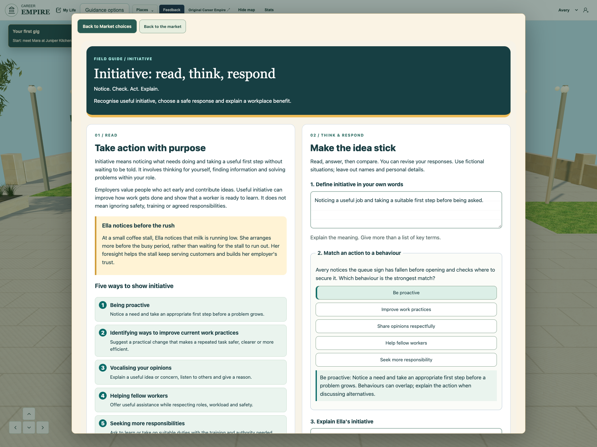
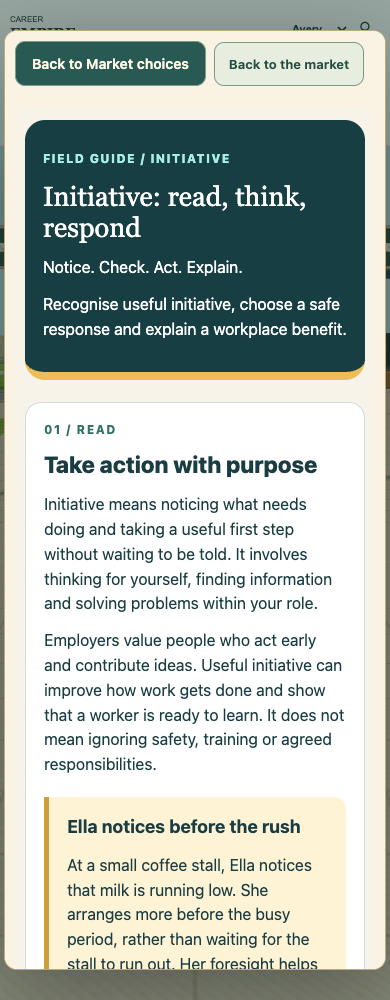

# Initiative Notes worksheet — 12 November 2026

## Request and source inspection

Tania requested Carolan text with worksheet-style multiple-choice and written response blocks in the game Notes, followed by an actual tested-game screenshot for the existing CEAWA Notes owner. All eight supplied originals were materialized with Library identity and visually inspected: Carolan printed24, section2.05, and seven older slides. The page names Michael Carolan, copyright2025 DELIVER Educational Consulting and its licensors, licensed for Emmanuel Catholic College. The existing shared library explicitly excludes original textbook pages/illustrations from public games. Originals remain private; the public reading is an attributed adaptation, retelling Ella’s coffee-stall example and retaining the five behaviours. No new artwork or copied textbook page is bundled.

## Before and after

The existing shared guide began with vocabulary cards and lacked a reading/response worksheet. The new responsive Notes opening pairs a readable attributed adaptation with definition, shared-bank behaviour choice, Ella explanation and benefit choice; the original transfer response, worked thinking, vocabulary, safety decisions and other practice remain available. It uses warm paper, teal panels, numbered behaviours and lined response areas. Existing feedback explains a reason and allows revision. A Journal Lecture notes shortcut now returns explicitly to the journal; entrance Notes returns to Market choices. Close returns to the world. The first browser check exposed the inherited480px dialog; that layout was corrected before final qualification.

## Curriculum, teaching and shared references

The exact existing shared library remains initiative-learning-r1 with unchanged SHAae97e51da217aca0cd8d4b7f438afea53a19e3fb0ff63cbf6009d7f56df36265. Shared term/check/source IDs remain common to Initiative and Careers Archon. CEM12-U3-EB-01 receives source-informed explanation and a written definition; EB-02 retains all five source-labelled behaviours plus shared-bank comparisons; EB-03 receives an action-to-effect explanation and the existing efficiency check, with broader benefit vocabulary/practice retained. This is authored teaching and formative practice, not proof of transfer, all nested requirements or formal assessment. Existing2027 baseline, reciprocal mappings, timing and remaining teacher checks are preserved. Older slides inform definition/scenario/benefit activities; their broad innovation material does not expand this bounded Notes task.

## Drafts, privacy and recovery

All answers remain within the existing same learner/run draft string, library revision and storage boundary. A versioned text envelope preserves multiple responses and selected choices, restores old plain-text explanations into their original transfer field, and never grades written work by keywords. Restoring choices does not duplicate attempts. Guest runs retain drafts only in document memory; save text explicitly explains the tab-only boundary and unconfirmed teacher sync. Structured drafts over4000 characters are refused before the existing host slice can corrupt JSON, while full edits remain available for the visit. Malformed old text is recoverable. No backend, provider, account, permission, retention or security setting is changed; fictional responses only.

## Exact qualification

Final source checks pass;386 unit tests across82 files pass with original limits, including four migration/round-trip/invalid/limit regressions. The final index manifest verifies352 runtime hashes and105 imports. Actual-game staged frontend checks at1280/390 and presentation1920 pass reading/five behaviours, wrong-then-correct feedback, three written responses, Back retention, no duplicate attempts, Close/Journal reopen, contextual return, Archon lobby and same run. There are no page errors, missing responses, browser Storage API calls or backend requests during the bounded guest checks. A separate real-adapter browser fixture passes legacy migration, save failure, learner isolation, retry, over-limit preservation and Escape cleanup. Initial close-event timing and missing Journal-route findings remain retained as dated failed runs. Safari, physical touch, student learning and classroom acceptance are unverified.

## Release and ownership

Owner: Integrate and test Initiative, sole game source/release integrator. Exact11 staged versions at7597b1a are listed below. The current Archon release, private capabilities, service, cleanup and existing Exit are preserved. User executing-chat approval remains the release authority; normal published integration/receipt guards remain mandatory. Game publication is pending this source review and is not implied by a successful build. Separately staged CI f156c32 and queued Chapel/EST/portfolio/Flyover work are excluded. CEAWA screenshot integration belongs to the existing presentation owner; this task must not overwrite their active source. Tania live review and presentation publication remain separate.

## Security and school boundary

This changes how existing free-text Notes and existing practice choices are rendered and encoded inside the same learner-scoped draft; it does not add a collection category, remote collection, identifiers, destination, storage key, third party or teacher transport. Guest zero-storage/zero-backend checks and injected save-failure/isolation tests verify that narrow boundary. Existing school-deployment/ST4S gaps are not certified or waived. Private supplied source pages and browser-seat capabilities are excluded from public output.

## Exact source files

- `modules/initiative/parallel/learning/lesson.css` — `100644:738f272fd32a8ac8fc4a56f1671918d4852d7270`
- `modules/initiative/parallel/learning/lesson.mjs` — `100644:3f52c0fb4e0286b80419b056b1352433d90ab8b9`
- `modules/initiative/parallel/learning/notes-worksheet.mjs` — `100644:782452599936f7ada7dbd0f813ade8e3307d7a91`
- `playable-3d/app.js` — `100644:d608909250106262f3aecb3b83f22fad776f80ca`
- `playable-3d/guest-shell.mjs` — `100644:7bb9a61ec86c60f2044b32084af2a80ddd7667ae`
- `playable-3d/index.html` — `100644:01e7cb73b72ecee71020d9bf43f4371ddde36eb3`
- `playable-3d/initiative-market.mjs` — `100644:fb63dbaea1b955eca613c0a0db5670134fb8402b`
- `playable-3d/market-learning-routes.mjs` — `100644:b8c5830707ded60c6b942739f362b54c85827c85`
- `playable-3d/night-market.js` — `100644:386cd202eafe61d435c5796d26725cb99dfa06b7`
- `playable-3d/release-manifest.json` — `100644:dde9fdf1ca917a0ebc8c9df8b22dc309c119d652`
- `tests/unit/notes-worksheet.test.mjs` — `100644:0199e9f30fcca4d52e01ebf18e0cb1c77d2c45a2`

## Actual game captures

The screenshot shows fictional responses in the implemented and tested game. It is not a mockup, live-deployment proof or Tania acceptance.

## Publication blocked; exact candidate preserved

Automatic approval review rejected publication of the new Notes integration and screenshots to the public Blueprint because the in-game worksheet and CEAWA screenshot request did not explicitly authorize this external publication. The command did not execute; no journal or public change was made. Public Blueprint remains169c52bb03189231ce6caf7d296a073ad1fc0d56; live game remains7597b1a. No Notes receipt, game commit or push was attempted.

The tested11-file candidate and local-only.patch remain under modules/initiative/parallel/integration/notes-worksheet-successor. The protected checkout is restored to the actual published game plus only its original staged CI repair. No denied operation was retried or routed around the guard. The actual-game screenshot is ready for the existing CEAWA owner; insertion/publication there is not claimed.

## Publication approval verified — 12 November 2026

The authenticated owner replied yes at15:28:58UTC to the exact request to publish the supporting Notes integration record/screenshots to the public Blueprint, then release the worksheet in the game. The executing integrator independently read both messages. This resolves the earlier missing-authorization rejection; the earlier command did not execute and was not retried before this new evidence. Both remotes remain at the reviewed base. All11 candidate hashes and actual staged bindings match the previously qualified386/82,352/105 and desktop/phone/presentation browser evidence. No new product bytes were authored. Licensed originals remain private; the reading is an attributed adaptation. Normal guard, genuine receipt and independent live verification still precede any release claim.

## Verified game publication — 12 November 2026

Notes worksheet 250c409e0b3587c23401d50ec5e7a4f08caf0ec0 is published and independently verified at the actual Career Empire GitHub Pages game. Pages43250263108 succeeded; all352 public runtime asset hashes match. Actual live1280/390 and1920 capture checks pass attributed reading/five behaviours, shared-bank wrong/correct feedback, written answers, Back/Close/Journal reopening, contextual Journal return, Archon lobby and same-run retention. Guest Notes checks make zero Storage API calls and zero backend requests; no page errors or missing responses. Source386tests/82files and352asset/105module checks pass. Required local CI source/unit passed; broad browser run recorded16pass/10fail/247not-run before graceful interruption after admin-entry modal and legacy-avatar failures. Remote source/unit passed, software browser installation failed and hardware lane was queued at observation. No all-CI-green, teacher submission, classroom, Safari or physical-device acceptance is claimed. Licensed originals remain private; only attributed adaptation and fictional responses are public. Existing CI/Chapel/EST/portfolio/Flyover candidates are preserved.

[Live game: Sunday Markets → Notes](https://emmanuel-ict-support.github.io/GTCEM-Career-Empire/playable-3d/?experience=sunday-markets) · [Successful Pages deployment](https://github.com/Emmanuel-ICT-Support/GTCEM-Career-Empire/actions/runs/43250263108).
