# Market entry, Initiative choices and clear shift completion

**Published and independently verified:** Initiative171 is published and independently verified at the actual Career Empire game as b647c325ad1700c2f440348b3d2cfe01ff307ab4. All419public runtime hashes match. Native public desktop1280/phone390 checks pass fresh/repeat walking and Enter, four separate choices, Mara-only scenario and explicit walk-to-Mara prompt, real cross-tab recording-lock recovery, retry/cancel/timeout/late navigation, readable crew dialogue and actual phone joystick. Two full non-perfect mixed-result shifts pass trial revision, manual learning review and Finish shift with all three real stages complete, existing1800wallet/200tax/crew pass and no invented initiative evidence. Game practice is not an assessed portfolio outcome.

428unit tests/95files and coverage pass;419assets/109imports pass. Actual public19cases pass, with1intentional desktop skip for the phone-only touch case. Controlled failure/lock/stale-index cases are distinguished from unmodified ordinary public flows. Required broad CI retains inherited Admin-preview failure/286not-run; no all-CI-green claim. Safari, physical devices, signed-in account saving, classroom and Tania acceptance remain separate. Existing authentication/privacy/state/economy and pending168/Flyover/CI are preserved.

Tania to check the actual live Initiative game, generic entry, Mara-only link and Market/map returns. Safari, physical-device/classroom, signed-in account saving and Tania acceptance remain separate. CEAWA and Blueprint final alignment are now published; no additional game release is required.

## Actual live final screens

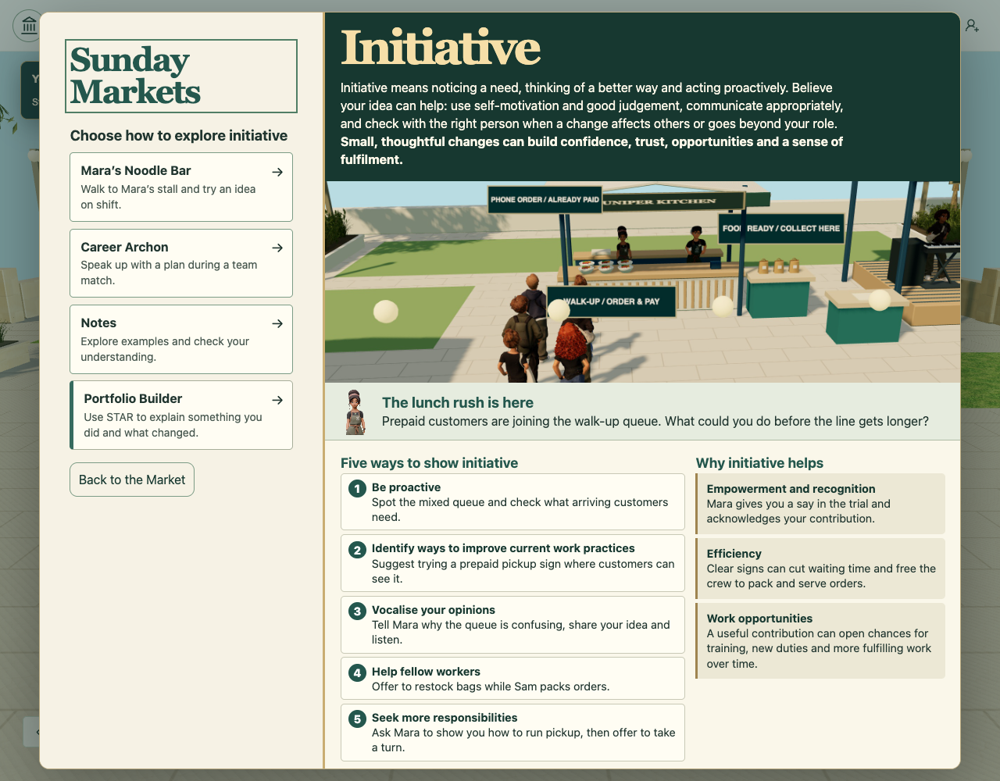

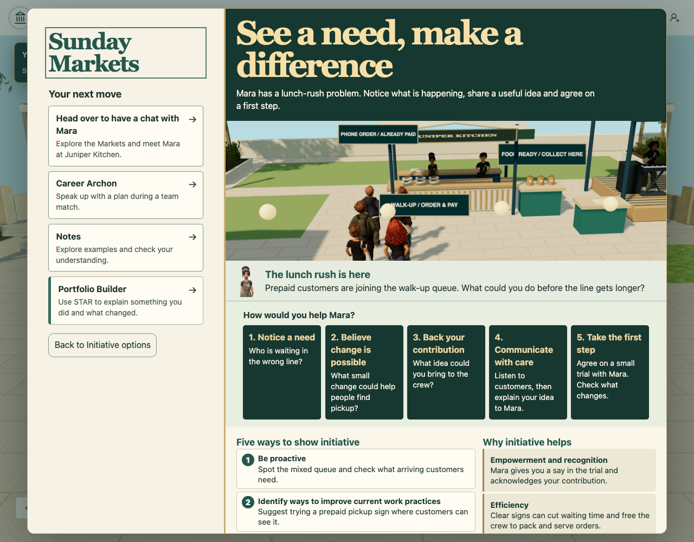

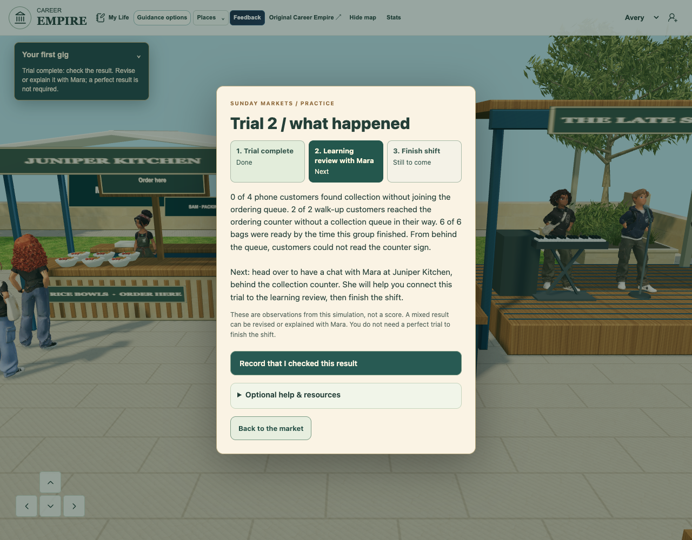

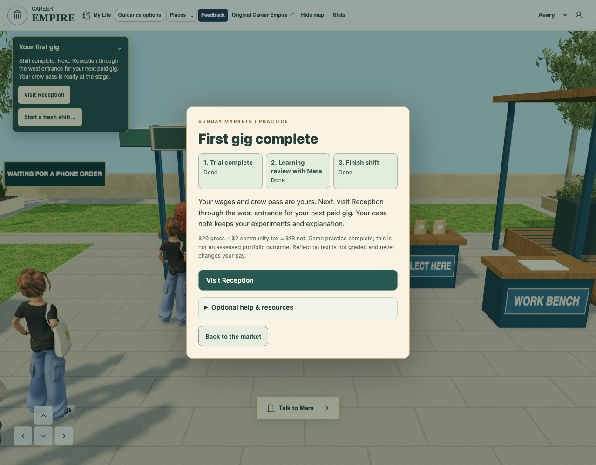

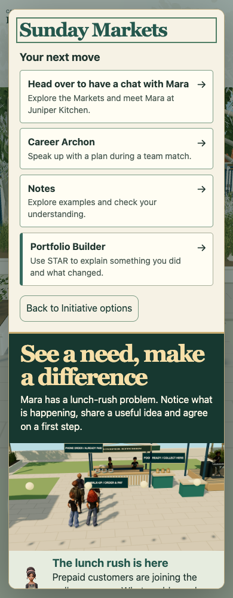

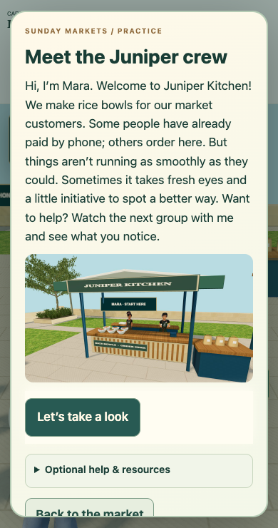

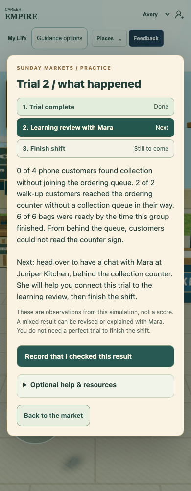

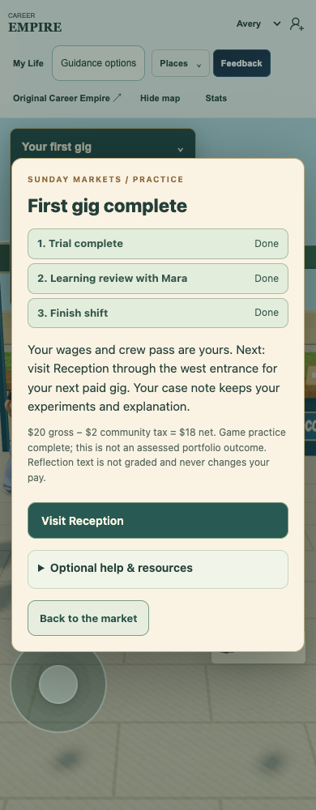

## Retained exact-source qualification history

# Market entry, Initiative choices and clear shift completion

CE-CHANGE-20261116-171. **Source review qualified; game successor deployment pending.** Existing password removal170is live as26614fe. This document is the prerequisite exact-source review for171, not proof of its game deployment.

## Retain the existing introduction

The supplied screenshot matches the earlier399a4daIntroduction: cream/forest/brass, the Market image, five ways, benefits and four practice options. That page is retained, with clearer self-motivation, judgement, communication and usefulness. Only choosing Mara’s Noodle Bar opens “See a need, make a difference”, followed by “Head over to have a chat with Mara”. Notes, Archon and Portfolio keep their own routes.

## Completed entry and recoverable loading

Both physical walk-in and Enter complete into a usable Market. A real sibling-tab Web Lock reproduced the published170hang: the scene opened, but marketOpening blocked movement until optional visit recording finished.171stops waiting on that unchanged idempotent recording. It also offers Enter at the actual approach and visible loading/cancel/retry, preserving timeout, duplicate and late-navigation guards. A missing optional status panel in a stale index cannot break startup. Genuine account authentication and student-record permissions remain intact.

## Readable conversation and clear completion

The existing “Meet the Juniper crew” dialogue expands to1040px on desktop, bounded by the viewport. Text, image and buttons are larger; phone controls remain reachable through safe scrolling. The existing native stall capture is sharper.

Trial complete → Learning review with Mara → Finish shift stays visible through results, review, handover and completion. Results explicitly direct students to walk to Mara at Juniper Kitchen. Progress reads existing milestones and writes no new state. Two mixed trials can be revised and explained, then finish for the same agreed game pay. A perfect trial is not required. Completion explicitly describes game practice, not an assessed portfolio outcome.

## Verification and limits

428unit tests across95files and coverage pass;419staged asset hashes/109imports pass.17native focused checks pass plus one desktop skip for the phone-only joystick case: fresh/repeat walking and Enter at1280/390, all four routes and Mara-only sequence, actual phone joystick, real cross-tab lock with eventual single visit, failed/stalled import/retry/cancel/late-navigation, stale-index compatibility,2047×979and390×740crew layout/fonts/image and controls. Two additional real-control full shifts pass desktop/phone: two mixed trials, revision, explicit walk back to Mara, manual learning review and actual Finish shift; all3stages complete, wallet1800/tax200/pass true, no invented initiative evidence. Required CI source/coverage pass; broad native browser stops at the inherited Admin-preview modal failure:1failed/286not-run. Failed initial harness/CSS/controller checks are retained; no all-CI-green, Safari, physical-device, signed-in-account or classroom acceptance claim.

Actual auth, shared services, dashboards/config, learning bank, state and economy reducers compare unchanged. No real learner data, backend permission, extra assessment gate, new fee or award logic. Supplied reference remains private. Pending168redesign, staged CIf156c32and CEAWA are excluded. CEAWA's existing owner will receive final live assets and exact update needs after the game is verified.

## Qualified local visual evidence

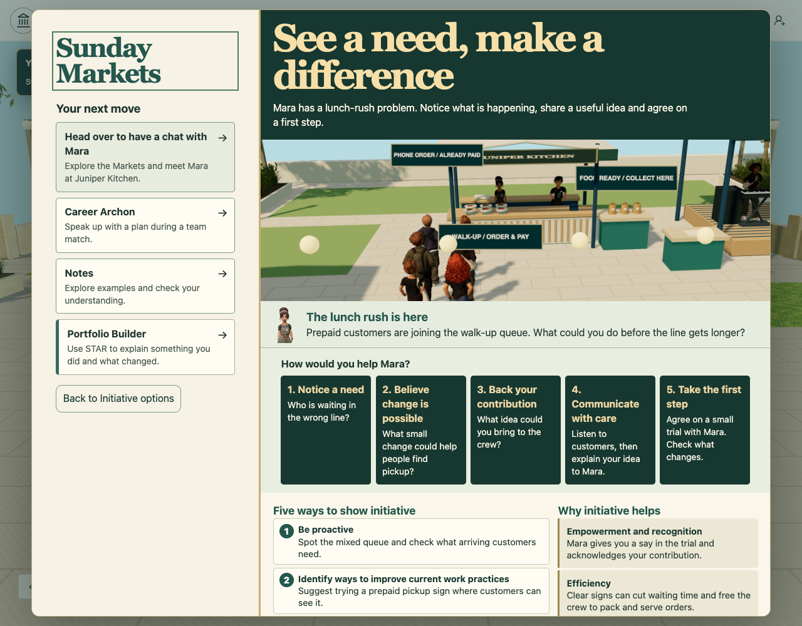

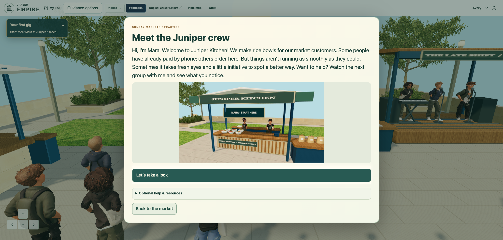

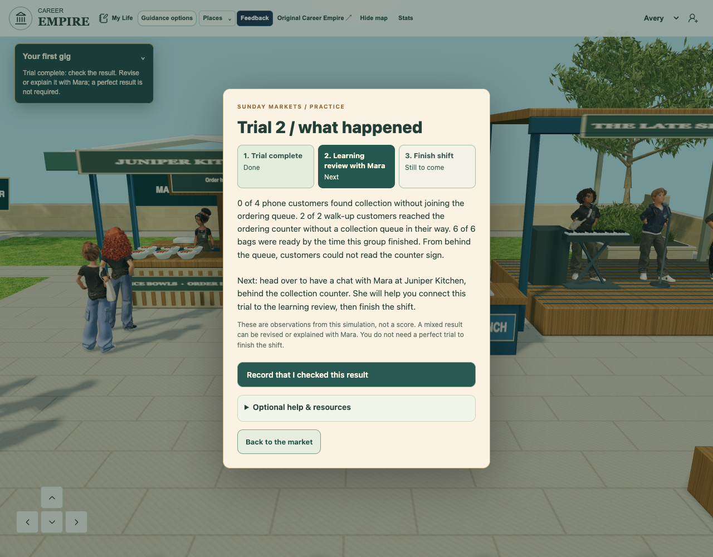

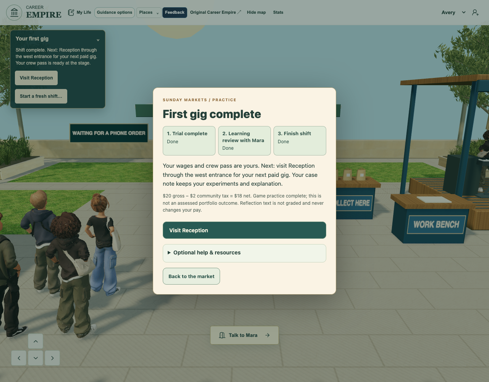

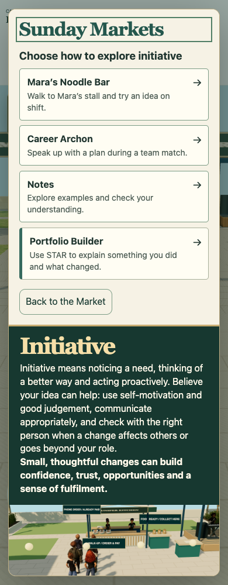

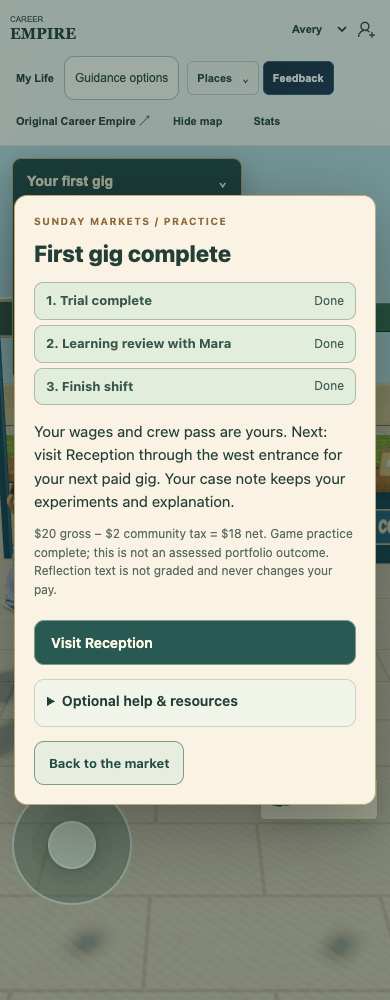

## Exact source and release boundary

Authoritative game base `26614fe9b60729261fdc414c7a344a37d5614d98`; Emmanuel-ICT-Support/GTCEM-Career-Empire main, root Pages. Actual game: https://emmanuel-ict-support.github.io/GTCEM-Career-Empire/playable-3d/ . Blueprint's embedded copy is a preview.

| Reviewed source | Exact Git mode/blob |
|---|---|
| `playable-3d/app.js` | `100644:b6d6e92d874b26ca0e252ccb966fcfde9cb8fb32` |
| `playable-3d/guest-shell.mjs` | `100644:59fb8eb867bdc360420ba57018277878a2182177` |
| `playable-3d/index.html` | `100644:6cdc8ee33fcf8602033307b65cfb0e0023620834` |
| `playable-3d/landing.mjs` | `100644:e844ef614135ebff1a7280656542654493012f6c` |
| `playable-3d/market-entrance/market-entrance.mjs` | `100644:102a1fe3f26b48c340c6a386086a21b5de9b12cf` |
| `playable-3d/market-teaching.mjs` | `100644:b0201696f72ea9c69b54c8ee8cebef392caaed36` |
| `playable-3d/night-market.css` | `100644:72283d85693fa7f6a11e3aeb1062d9fb40fce454` |
| `playable-3d/night-market.js` | `100644:47d8d92278a6efb8af5eb5777713dd6df0dd82d5` |
| `playable-3d/release-manifest.json` | `100644:fde19e0496f530977fce31fc26cd03ca062aab91` |
| `tests/e2e/classroom-gate.spec.js` | `100644:4515663896f6706a5ceebf2bf5e572f597f2acf8` |
| `tests/e2e/market-entry-flow.spec.js` | `100644:7bece79569be21f201b03e1938c6eb0157ba9c1c` |
| `tests/unit/market-entry.test.mjs` | `100644:9b49e213a333ed2dfb41af373d9bf9c6415d659a` |
| `tests/unit/market-shift-progress.test.mjs` | `100644:17a9a2208832d946e2507ba597c17cc3bc7f3900` |
| `tests/unit/runtime-recovery.test.mjs` | `100644:53f0ccc63f522363b53264791657cb226ebe61e0` |
| `tests/unit/software-navigation.test.mjs` | `100644:de5f20e8e839b039c535822bc45366959219e1b5` |
| `tests/unit/world-interaction-priority.test.mjs` | `100644:c6458f8c804568bd9bbf015751bf5c159ba3b2ec` |

Independently verify this exact public source review, obtain a genuine16-file receipt, publish the isolated successor on26614fe and verify actual live entry, all routes, mixed shift completion and public assets. Then publish truthful reader closeout and coordinate CEAWA with its existing owner; no concurrent CEAWA writer.

## Final CEAWA owner closeout

Existing CEAWA owner published final0a05fc95a13513cd6d27cd11e36a5e11b1040708 and reports actual desktop/phone presentation links/video pass. Integrator independently checked remote head, served Initiative links and historical-video label; both actual served introduction/Mara image SHA256s match the complete live captures. Existing video and unrelated Portfolio/Avatar work preserved.

Tania to check the actual live Initiative game, generic entry, Mara-only link and Market/map returns. Safari, physical-device/classroom, signed-in account saving and Tania acceptance remain separate. CEAWA and Blueprint final alignment are now published; no additional game release is required.
